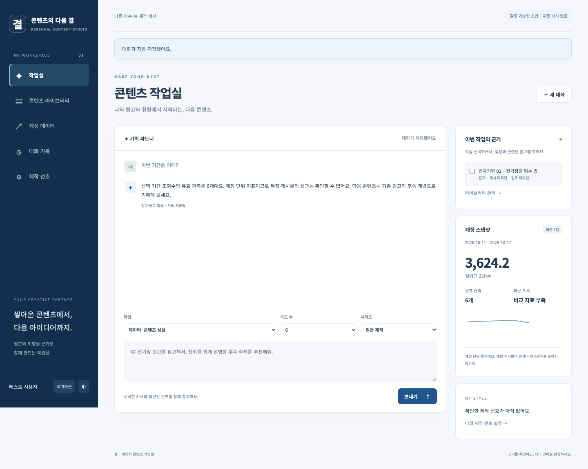
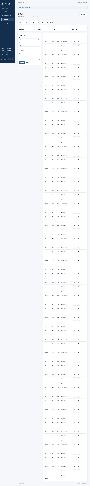
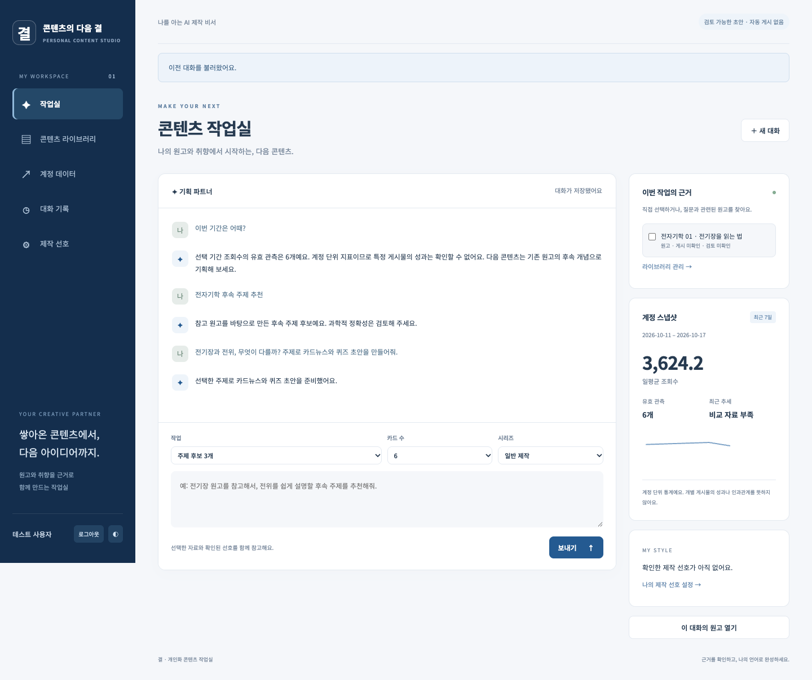

# 결 · 나를 아는 콘텐츠 제작 비서

기존 원고와 확인된 제작 선호를 참고해 **후속 주제 → 카드뉴스 원고 → 퀴즈 → 수정·보관**을 연결하는 개인 AI 작업실입니다.
[M1-1](https://github.com/gaori2952/M1-1)의 시계열은 계정 상황을 이해하는 보조 근거로 사용합니다. 계정 지표만으로 특정 게시물의 성공 원인을 단정하지 않습니다.

## 현재 상태

로컬 구현 및 자동 테스트를 완료한 초기 버전입니다. **Firebase·OpenAI 실제 연결과 Render·Vercel 배포는 아직 수행하지 않았습니다.**
키 미설정 상태에서는 화면과 Swagger를 열 수 있지만 로그인·데이터·생성 기능을 실제 서비스로 사용할 수 없습니다.

- 프론트 URL: 미배포
- 백엔드 API URL: 미배포
- Swagger URL: 미배포 (로컬: http://localhost:8000/docs)

[아키텍처](docs/architecture.md) · [구현 계획](docs/implementation-plan.md) · [검증 결과와 제한](docs/verification.md)

## 구현한 기능

- Google 로그인 + 허용 UID 검사, 모든 데이터 소유권 검사
- 시계열 CRUD, 유효 관측·결측 분리, 이전 동일 기간과 비교하는 요약
- 원고 라이브러리 CRUD, 선택 원고 또는 키워드 검색
- 일반 선호와 시리즈별 규칙의 명시적 확인·저장
- 데이터·근거·선호를 주입한 채팅, 후속 후보 3개, 카드 4~10장과 객관식 퀴즈
- 응답 구조·근거 ID 검사, 요청 중복 방지, 일일 요청 한도
- 대화 자동 저장·불러오기·삭제, 초안 수정과 버전 충돌 방지, 피드백 보관
- 반응형 바닐라 화면, 로딩/오류 안내, 그래프, JSON/Markdown 다운로드, 다크 모드

## 기술 스택

Python 3.10+ / FastAPI / Pydantic / firebase-admin / OpenAI Python SDK / python-dotenv.
프론트는 HTML·CSS·JavaScript와 Firebase Auth 웹 SDK이며 UI 프레임워크를 사용하지 않습니다.
배포 대상은 백엔드 Render, 프론트 Vercel입니다.

## 로컬 실행

Python 3.10+와 Node.js 22+가 필요합니다. 저장소 루트에서 실행하세요.

```bash
python3 -m venv .venv
source .venv/bin/activate
pip install -r backend/requirements.lock
cp .env.example .env
# .env에 백엔드 설정 입력
uvicorn app.main:app --app-dir backend --reload --port 8000
```

다른 터미널에서:

```bash
cp frontend/.env.example frontend/.env.local
# frontend/.env.local에 공개 Firebase 웹 설정 입력
node --env-file=frontend/.env.local frontend/build-config.mjs
python3 -m http.server 3000 --directory frontend/public
```

http://localhost:3000 접속. `file://`로 HTML을 직접 열지 마세요.
환경 변수 변경 후 백엔드를 재시작하고 프론트를 다시 빌드하세요.

## Firebase / OpenAI 준비

1. Firebase 콘솔에서 프로젝트와 웹 앱을 생성합니다.
2. Authentication → Sign-in method에서 Google을 활성화합니다. Authorized domains에 `localhost`와 실제 Vercel 도메인을 등록합니다.
3. Firestore Database를 생성하고 [firestore.rules](firestore.rules)를 적용합니다. 브라우저 직접 DB 접근은 거부하고 백엔드에서만 접근합니다.
4. Project settings → Service accounts에서 서비스 계정 JSON을 준비합니다. 파일 내용을 `.env`의 `FIREBASE_SERVICE_ACCOUNT_JSON`에 단일 줄 JSON으로 넣습니다. 예: `FIREBASE_SERVICE_ACCOUNT_JSON='{"type":"service_account",...}'`. 키 파일이나 실제 값은 Git·채팅에 올리지 마세요.
5. 웹 앱의 Firebase configuration을 `frontend/.env.local`의 `FIREBASE_WEB_CONFIG`에 넣습니다. 이것은 공개 클라이언트 설정이며 서비스 계정 JSON과 다릅니다.
6. 화면에서 Google 로그인 한 번 후 Firebase Authentication 사용자 목록에서 UID를 확인하고 백엔드 `ALLOWED_USER_UIDS`에 입력합니다. 그 전까지 백엔드의 403 응답은 정상적인 접근 제한입니다.
7. OpenAI API 키를 백엔드 `.env`의 `OPENAI_API_KEY`에 넣습니다. API 사용 권한이 있는 모델을 `OPENAI_MODEL`로 선택하세요. ChatGPT 구독과 API 이용은 별개입니다.
8. 서버 재시작 후 CRUD부터 확인하고 모델 호출은 후보/원고 각 1회로 작게 시작하세요.

## 환경 변수

| 위치 | 변수 | 설명 |
| --- | --- | --- |
| 백엔드 | OPENAI_API_KEY | OpenAI API 키 |
| 백엔드 | OPENAI_MODEL | 기본 `gpt-6.1-sol`; 계정에서 사용할 수 있는 구조화 출력 지원 모델 |
| 백엔드 | FIREBASE_SERVICE_ACCOUNT_JSON | 서비스 계정 JSON 문자열 |
| 백엔드 | ALLOWED_USER_UIDS | 쉼표로 구분한 허용 Firebase UID. 비어 있으면 아무도 허용하지 않음 |
| 백엔드 | ALLOWED_ORIGINS | 쉼표로 구분한 정확한 프론트 origin. 기본 `http://localhost:3000` |
| 백엔드 | MAX_OUTPUT_TOKENS | 기본 4000, 허용 범위 256~8000 |
| 백엔드 | DAILY_REQUEST_LIMIT | 사용자별 일일 모델 시도 한도, 기본 30, UTC 자정 초기화 |
| 프론트 빌드 | API_BASE_URL | 백엔드 주소, 브라우저에 공개됨 |
| 프론트 빌드 | FIREBASE_WEB_CONFIG | Firebase 웹 설정 JSON, 브라우저에 공개됨 |

프론트 빌드는 허용된 Firebase 공개 필드만 받습니다. OpenAI 키와 서비스 계정은 Render에만 설정합니다.
`.env*`, `frontend/config.js`, `frontend/public/`, `.private/`는 Git에서 제외됩니다.

## 개인 자료 가져오기

M1-1 기준: 커밋 `70d0b8451a87a78433c4a40e48df48026547d636`, `data/processed/daily.csv`.
139일 × 6지표 = 834슬롯 중 833개가 유효 수치입니다. 2026-10-14 팔로우는 결측으로 보존합니다.
실제 CSV와 GPT 대화 원문은 이 공개 저장소에 포함하지 않습니다. 로컬 `.private/`에 준비하세요.

```bash
# 검증만 수행 (클라우드 연결 없음)
PYTHONPATH=backend python -m scripts.import_sources --kind metrics \
  --file .private/daily.csv --uid YOUR_FIREBASE_UID --dry-run
# 위 결과 확인 후 실제 Firestore에 가져오기
PYTHONPATH=backend python -m scripts.import_sources --kind metrics \
  --file .private/daily.csv --uid YOUR_FIREBASE_UID --apply
```

날짜·지표별 안정적인 ID를 사용합니다. 재수입은 기존 문서를 건너뛰어 사용자 수정을 보존합니다.
원고 JSON은 `ContentInput` 형태의 배열입니다. `title`, `text`가 필수이며 `source`에 원본 대화/메시지 ID를 기록할 수 있습니다.
`--kind contents`로 같은 절차를 사용합니다. 안정적인 고유 `source`를 권장합니다.
검토 전 GPT 원고는 사실 검증 자료가 아니며 게시 상태 `unknown`, 검토 상태 `unverified`로 가져옵니다.

## API와 구조

```
backend/app/
  main.py              앱·CORS·오류 처리
  auth.py, config.py   인증·설정
  models.py            요청·모델 응답 검증
  store.py             Firestore 어댑터
  repository.py        소유권과 저장 연산
  analytics.py         결정적인 통계 계산
  content_search.py    원고 선택·키워드 검색
  generation.py        OpenAI 구조화 응답·근거 검사
  chat_service.py      컨텍스트·예약·한도·원자적 저장
  routes/              HTTP 엔드포인트
frontend/              바닐라 화면과 공개 설정 빌드
backend/tests/         테스트 전용 저장소·인증·모델
```

필수 API: `POST/GET /api/data`, `PUT/DELETE /api/data/{id}`, `GET /api/data/summary`,
`POST/GET /api/conversations`, `GET/DELETE /api/conversations/{id}`, `POST /api/chat`.
추가 API는 원고, 프로필, 시리즈, 초안 CRUD/검토입니다. 전체 계약은 `/docs`에 있습니다.
Swagger Authorize에 Firebase ID 토큰을 입력해야 보호 API를 호출할 수 있습니다.

- 데이터 summary는 기본 최신 기록 기준 7일. `start`와 `end`를 함께 주면 최대 366일을 조회합니다.
- 대화 목록에는 messages가 없고 상세 API에는 시간순 messages가 있습니다.
- 채팅은 UUID `request_id`를 받습니다. 같은 요청은 저장된 응답을 재사용하고, 다른 내용에 같은 ID를 쓰면 409입니다.
- 요청 실패 후 새 ID로 다시 시도하는 것은 새로운 모델 호출입니다. 자동 재호출은 없습니다.
- 동시 대화 생성은 대화별 예약으로 제한하고, 성공 메시지와 원고는 하나의 트랜잭션으로 저장합니다.
- 프롬프트는 통계를 직접 계산하지 않습니다. `/api/data/summary`와 채팅이 같은 Python 요약 함수를 사용합니다.

## 테스트

```bash
pip install -r backend/requirements-dev.txt
python -m pytest -q
ruff check backend
ruff format --check backend
```

브라우저 테스트에는 Playwright Chromium이 필요합니다.

```bash
npm install --no-save playwright
npx playwright install chromium
# 터미널 1: 합성 자료 + 모의 모델 전용 서버
PYTHONPATH=backend python -m uvicorn tests.preview:app --host 127.0.0.1 --port 18100
# 터미널 2: 테스트용 공개 API 주소로 빌드 후 정적 서버
API_BASE_URL=http://127.0.0.1:18100 node frontend/build-config.mjs
python -m http.server 18101 --bind 127.0.0.1 --directory frontend/public
# 터미널 3
node tests/e2e/flow.mjs
```

E2E는 임시 브라우저에서 `auth.js`만 대체합니다. 운영 코드에 인증 우회 플래그는 없습니다.
테스트용 서버는 외부에 배포하지 마세요. 반복 테스트는 새 preview 서버로 시작하세요.

## 배포 준비

**Render**: 이 저장소를 연결해 `render.yaml` Blueprint를 사용하거나 Web Service의 Root Directory를 `backend`, Build Command를 `pip install -r requirements.lock`, Start Command를 `uvicorn app.main:app --host 0.0.0.0 --port $PORT`로 설정합니다. 위 백엔드 환경 변수를 입력하세요.

**Vercel**: Root Directory `frontend`, Framework `Other`, Build Command `node build-config.mjs`, Output Directory `public`. `API_BASE_URL`과 `FIREBASE_WEB_CONFIG`를 설정합니다. 배포 시 HTTPS API 주소와 Firebase 공개 설정이 없으면 빌드가 실패합니다.

배포 후 Render의 `ALLOWED_ORIGINS`에 정확한 Vercel origin을, Firebase Authorized domains에 Vercel 호스트를 추가하세요.
프리뷰 도메인은 필요한 주소만 개별 허용합니다. 화면은 8초 이상 대기 시 콜드스타트 안내를 표시합니다.
`/health`의 configured는 환경 변수 존재 여부이며 실제 서비스 연결 성공을 보증하지 않습니다.

## 화면 예시

아래 이미지는 **합성 데이터·모의 모델을 사용한 로컬 테스트 화면**입니다. 실제 배포 제출용 스크린샷은 운영 연결 확인 후 교체해야 합니다.




