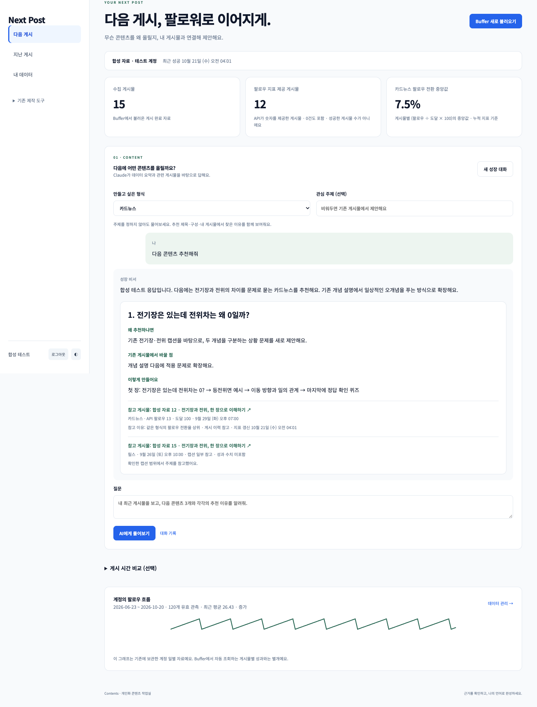
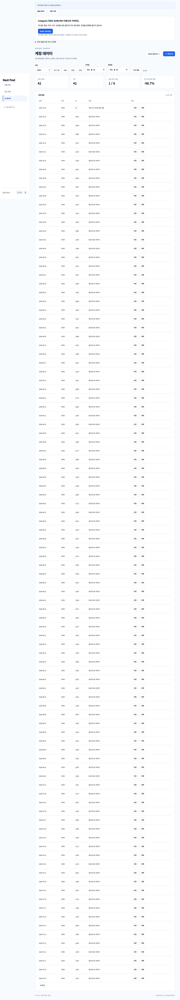
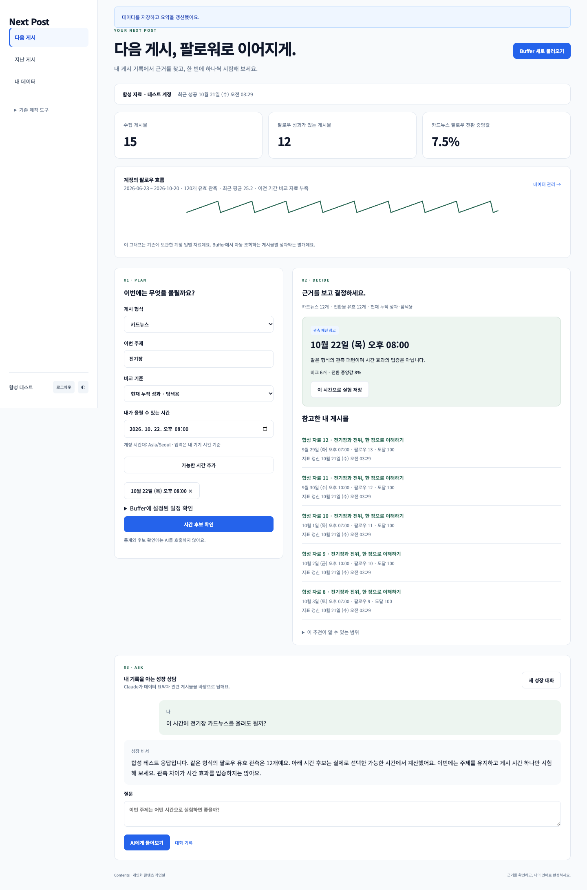
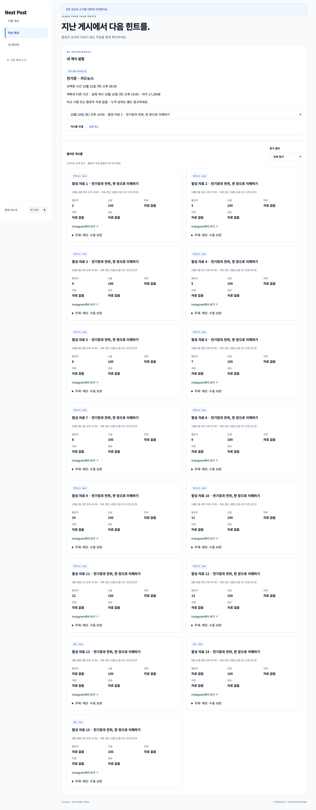
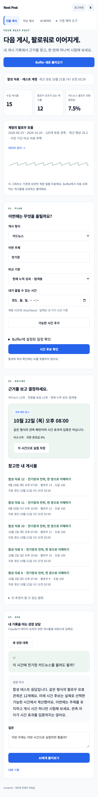

# Next Post · 내 Instagram과 대화하기

Buffer에 연결된 내 Instagram 게시물과 대화하는 개인 AI 비서입니다. **게시물 찾기, 새 초안 비교, 기존 글 재활용, 게시 결과 피드백, 시리즈 정리**를 한 대화창에서 요청합니다. 관련 카드 이미지에서 읽은 내용은 저장해 다음 질문에 재사용합니다. 사용자의 기본 목표는 팔로워 성장입니다.

## 사용하는 순서

1. Google 로그인 후 **Buffer 새로 불러오기**를 누릅니다. 화면에서 가져온 시각·최신 게시일·게시물 성과 갱신 시각을 구분해 확인할 수 있습니다. 게시물·캡션·첨부물 정보·실제 게시 시각·성과·설정된 게시 일정을 읽습니다.
2. **Instagram 대화**에서 “전기장 관련 글 찾아줘”, “잘된 글을 퀴즈로 재활용해줘”, “이 초안이 기존 글과 겹쳐?”처럼 질문합니다. 초안 이미지는 최대 10장 첨부할 수 있습니다. 형식·시간 설정 없이 시작합니다.
3. 질문과 관련된 이미지 게시물 중 아직 읽지 않은 글은 질문당 최대 한 개를 읽습니다. **지난 게시**에서도 특정 글을 직접 읽거나 대화에 선택할 수 있습니다. 답변의 참고 카드에서 읽은 장 수·본문 요약·게시물 링크를 확인합니다. 재활용 원고는 **작업 결과**, 이어서 쓸 자료는 **GPT로 가져갈 내용 복사**로 꺼냅니다. 질문·답변·작업 결과·당시 근거는 자동 저장됩니다.
4. 날짜도 비교하고 싶으면 **게시 시간 비교 (선택)**를 펼치고 다음 7일 중 실제 가능한 시간을 추가합니다. **시간 후보 확인**은 AI 호출 없이 최대 두 후보와 이유·비교 게시물을 보여줍니다. 시간대 비교에는 콘텐츠 주제를 반영하지 않습니다.
5. 시간 후보의 **이 시간으로 실험 저장**을 누른 뒤, 실제 게시 후 **지난 게시**에서 해당 글을 직접 연결합니다. 계획과 실제 게시 시간의 차이, 관측 성과와 자료 부족을 확인합니다.
6. **내 데이터**는 최신 Buffer 게시물·성과를 조회하는 화면입니다. 원본 수치는 수정·삭제할 수 없습니다. M1-1 일별 기록은 마지막 날짜가 표시된 **보관된 일별 기록**에서 조회하며, CRUD는 별도 **직접 기록**에만 적용합니다. 데이터 JSON 내보내기는 제공하지 않습니다. CSV는 **이전 일별 자료 추가 (선택)** 안의 보조 기능이며, Instagram 정보를 조회하는 데 필요하지 않습니다.

**이미지 검토**에서 완성된 카드뉴스 이미지를 여러 장 올려 장별 검토와 수정본 재검토를 할 수 있습니다. **대화 기록**은 독립 메뉴로 제공합니다. 원고 생성·카드 편집·원고함·콘텐츠 라이브러리·제작 선호는 기본 메뉴에서 제외했습니다. 기존 저장 자료와 이전 대화의 열람 경로는 보존합니다.



## 현재 상태

- 한 대화창에서 게시물 검색·이미지 초안 비교·재활용·결과 피드백·시리즈 정리·GPT 복사를 제공하며, 통계·시간 후보는 선택 영역으로 접었습니다.
- 실제 Buffer 읽기와 사용자 승인 후 본인 Firestore에 저장·재조회하는 연결을 확인했습니다. 로컬 테스트는 별도로 수행합니다. 아래 화면은 **합성 데이터와 테스트 생성기**이며 실제 계정 성과나 AI 답변의 증명이 아닙니다.
- 성장 상담도 기존 `LLM_PROVIDER` 설정을 사용합니다. 현재 사용자의 Anthropic 호환 API로 실제 성장 상담 응답을 확인했습니다. OpenAI 키를 추가로 요구하지 않습니다. 선택한 제공업체의 키가 없을 때만 설정 필요 상태를 표시합니다.
- 짧은 캡션만으로 본문을 추정하던 문제를 줄이기 위해 이미지 본문 읽기와 출처별 저장을 추가했습니다. 실제로 읽은 장의 내용만 근거로 전달하며, 미제공 장이나 영상 본문을 읽었다고 처리하지 않습니다. 자동 테스트 통과는 실제 개인화 추천 품질 통과와 별개입니다.
- 2026-10-26 로컬 실제 검증: 본인의 카드뉴스 한 개(이미지 2장)를 현재 Anthropic 호환 API로 읽고 Firestore에 저장·재조회했습니다. 이미지와 판독문을 대조하고, 확인된 본문을 바탕으로 후속 원고 한 개가 생성되는 것을 확인했습니다. 수식 전체의 정확성이나 모든 게시물의 추천 품질을 검증한 것은 아닙니다.
- **2026-10-26 운영 반영 완료:** [PR #9](https://github.com/gaori2952/M1-2/pull/9)를 `main`에 병합했습니다. Vercel 프론트와 Render 백엔드에서 새 화면·성장 API·로그인된 계정의 Buffer 동기화를 확인했습니다. 배포 성공과 위의 추천 품질 한계는 구분합니다.
- 운영 주소: [프론트](https://m1-2-frontend-theta.vercel.app/) · [백엔드 상태](https://m1-2-6ae7.onrender.com/health) · [Swagger](https://m1-2-6ae7.onrender.com/docs).

검증 명령과 범위는 [검증 기록](docs/verification.md)에 있습니다.

## 수치와 추천의 의미

- **팔로우 지표 제공 게시물:** Buffer가 `follows` 숫자를 제공한 게시물 수이며 **0건도 포함**합니다. 성공한 게시물 수가 아닙니다.
- 기본 팔로워 상담에는 팔로우·도달 지표를 전달합니다. 질문에 저장·공유·조회 등 다른 지표를 명시하면 해당 성과도 전달합니다. 원본 지표는 별도로 유지합니다.
- **팔로우 수:** 플랫폼이 해당 게시물에 귀속한 값입니다. 전체 팔로워 수 또는 계정 순증이라고 바꾸어 해석하지 않습니다.
- **전환율:** `게시물 팔로우 / 도달 × 100`. 팔로우가 알려지고 도달이 양수일 때만 계산합니다. 누락은 0이 아닙니다.
- 릴스·카드뉴스·단일 게시물·스토리를 따로 비교합니다. 팔로우 지표가 없는 형식은 조회·저장·공유를 팔로우의 정답으로 사용하지 않습니다.
- 시간대는 계정 시간대의 실제 게시 시각을 3시간 구간으로 묶습니다. 구간당 3개·서로 다른 2일 이상인 구간이 둘 이상일 때 관측 비교를 제공합니다. 이는 제품의 최소 표본 규칙이며 통계적 유의성이나 원인 규명이 아닙니다.
- **현재 누적 성과**는 게시 후 경과 시간이 서로 다른 탐색 자료입니다. **7일차 부근 관측**은 실제로 저장된 소스 갱신 시점이 게시 후 6~8일인 자료만 사용합니다. 과거 값을 현재 누적값에서 만들어 내지 않습니다.
- 비교 표본이 부족한 시간은 **새 실험**으로 표시합니다. 기대 팔로우 수·개선 확률·최적 시간 보장은 제공하지 않습니다.
- Buffer의 성과 API는 실험적이며 개인 키를 통한 개인 사용 범위입니다. 지표 갱신은 지연될 수 있습니다. 마지막 성공 수집 시각과 지표 갱신 시각을 확인하세요. [공식 제한 안내](https://support.buffer.com/en-us/articles/what-is-buffers-api-GtIYIQilz5)
- 계정 일별 팔로우와 게시물별 팔로우는 별개입니다. 일별 값을 게시물에 나누어 배정하지 않습니다.

대화에서 선택한 게시물을 우선하고 질문과 관련된 캡션·저장된 이미지 본문, 전환율 상위 글, 최근 글을 섞어 상세 근거를 최대 5개 선택합니다. 최근 최대 60개의 캡션 앞부분과 저장된 본문 요약도 주제 참고에 활용합니다. 이미지 읽기는 Buffer가 제공한 지원 이미지 중 최대 10장으로 제한되며, 영상 본문은 읽지 않습니다. 팔로우 지표가 없는 글도 주제 참고로 사용할 수 있습니다. 높은 지표는 기획 판단의 참고이며 추천 주제의 효과를 증명하지 않습니다.

## 게시물 본문 기억

서버가 소유 계정의 Buffer 첨부물 주소만 확인해 이미지를 가져오고, 현재 설정된 AI의 이미지 입력으로 읽습니다. 캡션, 장 순서, 원본 출처가 같은 게시물은 저장된 판독 결과를 재사용합니다. 출처가 바뀌거나 새 판독에 실패하면 이전 성공 기록을 덮어쓰지 않습니다. 본문 읽기와 대화는 같은 일일 AI 한도를 사용합니다.

Firestore에는 판독한 글·수식·요약·주제·장별 판독 여부를 저장하며 원본 이미지 파일은 저장하지 않습니다. 첨부한 새 초안은 AI 요청에만 포함되고 서버 대화 기록에는 파일명·해시만 남습니다. 같은 브라우저에서는 사용자별 IndexedDB로 이미지를 복원합니다. 다른 기기에서는 원본 초안을 다시 첨부해야 합니다. GPT 복사는 공개 게시물 링크와 답변·근거 텍스트를 클립보드에 복사하며 외부 대화를 자동 전송하지 않습니다.

## 기술과 데이터 흐름

- Python 3.10+, FastAPI, Pydantic, firebase-admin, OpenAI SDK, Anthropic SDK, python-dotenv
- 바닐라 HTML/CSS/JavaScript, Firebase Authentication Google 로그인
- Firebase Firestore: 사용자 소유권 검사 후 서버에서만 접근
- Render 백엔드, Vercel 정적 프론트
- 차트는 SVG로 구현하며 UI 프레임워크·벡터 DB·새 에이전트 런타임은 사용하지 않습니다.

```text
Google 로그인 → FastAPI 소유 UID 검사
  → Buffer 고정 읽기 쿼리 → 전체 페이지 검증
  → Firestore 새 수집 세대 저장 → 완료 후 성공 포인터 변경
  → Python 통계·시간 후보 계산 → 화면
  → 관련 이미지 게시물 읽기 → 소유자별 본문 기억 저장
  → 질문 + 계정 일별 요약 + 관련 게시물 본문 + 새 초안 → 설정한 AI 제공업체
  → 질문·답변·작업 결과·당시 근거 자동 저장 → GPT 복사 / 게시 결과 확인
```

수집이 중간에 실패하면 이전 성공 자료를 유지합니다. 화면의 새로 불러오기는 `force: true`로 원본을 다시 조회합니다. 기본 API 요청은 최근 60분 내 성공 자료를 재사용하며, 원본 수집 시도는 사용자별 UTC 하루 5회입니다. 같은 요청 ID의 재시도는 중복 수집하지 않습니다. 모델 요청은 별도의 일일 한도를 사용합니다. 자동 게시·예약 변경·댓글/DM 처리는 하지 않습니다.

## 로컬 실행

Python 3.10+와 Node.js 22+가 필요합니다. 저장소 루트에서 실행합니다.

```bash
python3 -m venv .venv
source .venv/bin/activate
pip install -r backend/requirements.lock
cp .env.example .env
# .env에 아래 서버 환경 변수 설정
uvicorn app.main:app --app-dir backend --reload --port 8000
```

다른 터미널에서:

```bash
cp frontend/.env.example frontend/.env.local
# 공개 Firebase 웹 설정과 API_BASE_URL 입력
node --env-file=frontend/.env.local frontend/build-config.mjs
python3 -m http.server 3000 --directory frontend/public
```

[로컬 화면](http://localhost:3000) · [로컬 Swagger](http://localhost:8000/docs). 환경 변수 변경 후 API 재시작·프론트 재빌드가 필요합니다.

### 서버 환경 변수

- `OPENAI_API_KEY`: `LLM_PROVIDER=openai`로 선택했을 때 필요한 서버 키. 채팅에 붙여 넣거나 Git에 저장하지 않습니다.
- `OPENAI_MODEL`: 계정에서 이용 가능하고 구조화 출력을 지원하는 실제 OpenAI 모델 ID.
- `FIREBASE_SERVICE_ACCOUNT_JSON`: Firebase 서비스 계정 JSON. 공개 웹 설정과 다릅니다.
- `ALLOWED_USER_UIDS`: 앱 사용을 허용한 Firebase UID 목록. 비어 있으면 차단합니다.
- `ALLOWED_ORIGINS`: 정확한 프론트 origin 목록. 로컬 예: `http://localhost:3000`.
- `BUFFER_API_KEY`: `account:read`, `posts:read`, `insights:read` 범위의 개인 읽기 키.
- `BUFFER_CHANNEL_ID`: 본인의 연결된 Instagram 채널 ID.
- `BUFFER_OWNER_UID`: 이 Buffer 키의 자료에 접근할 Firebase UID 한 개. 다른 허용 UID에는 공유하지 않습니다.
- `MAX_OUTPUT_TOKENS`: 모델 출력 상한. `DAILY_REQUEST_LIMIT`: 사용자별 UTC 일일 모델 요청 시도 한도.
- `LLM_PROVIDER`: 성장 상담과 기존 제작 도구가 함께 사용하는 `openai`/`anthropic` 설정입니다. 이미 준비한 제공업체를 그대로 사용합니다.
- Anthropic을 선택한 경우 `ANTHROPIC_API_KEY`, `ANTHROPIC_MODEL`, 선택 `ANTHROPIC_BASE_URL`을 설정합니다.

### 프론트 환경 변수

- `API_BASE_URL`: 백엔드 주소. Vercel 빌드에서 정적 공개 설정으로 내보냅니다.
- `FIREBASE_WEB_CONFIG`: Firebase 공개 웹 설정 JSON. `apiKey`, `authDomain`, `projectId`, `appId` 등 허용된 웹 설정만 넣습니다. 서비스 계정·Buffer·모델 키를 넣지 않습니다.

### Firebase·Buffer 준비

1. Firebase Authentication에서 Google 로그인을 활성화하고 Authorized domains에 `localhost`와 Vercel 호스트를 등록합니다.
2. Firestore를 생성하고 [firestore.rules](firestore.rules)를 적용합니다. Admin SDK는 규칙을 우회하므로 서버의 소유권 검사도 유지합니다.
3. 사용할 로그인 UID를 `ALLOWED_USER_UIDS`, Buffer 자료 소유 UID를 `BUFFER_OWNER_UID`에 설정합니다.
4. Buffer API 설정에서 읽기 범위의 개인 키를 발급해 서버에만 저장합니다. 키 만료·권한 오류는 화면에 안내하며 새 키를 코드에 하드코딩하지 않습니다.
5. Buffer 채널 ID를 설정하고 로그인 후 **새로 불러오기**를 실행합니다. 계정의 조직에서 해당 채널을 확인한 뒤 수집합니다.

## 데이터 날짜와 갱신 범위

- **가져온 시각**은 우리 서버가 Buffer를 조회한 시각이며, **최신 게시일**은 실제 게시물 날짜입니다. **성과 갱신 시각**은 Buffer가 원본 성과를 수집한 시각입니다. 게시물마다 다를 수 있어 범위와 시각 미제공 개수도 표시합니다.
- Buffer 성과는 일 단위로 갱신되어 원본 Instagram보다 최대 약 24시간 늦을 수 있습니다. 새로 불러오기가 Instagram 자체의 수집 주기를 앞당기지는 않습니다. [공식 Post Metrics 안내](https://developers.buffer.com/guides/post-metrics)
- 계정 일별 기록은 별도의 과거 자료입니다. Buffer API는 Insights 화면의 전체 계정 일별 통계를 제공하지 않으므로, 새로 불러오기로 이 기록을 최신 날짜까지 채우지 않습니다. 첫 화면에서는 **과거 계정 일별 기록 · 마지막 유효 날짜**로 구분해 접어 둡니다. 누락 날짜를 0이나 추정값으로 만들지 않습니다. [공식 지원 범위](https://support.buffer.com/articles/using-buffers-api-GtIYIQilz5)
- 화면은 블랙·화이트를 기본으로 사용하고, 작은 화면에서는 날짜·지표 카드를 한 열로 정렬합니다.

## 이전 일별 자료 추가 (선택)

**Instagram 게시물·성과의 기본 수집 경로는 Buffer API입니다. CSV 등록은 필요하지 않습니다.** 이 기능은 과거 계정 일별 자료를 추가하는 선택 도구입니다. 과제의 100개 이상 시계열 관측은 기존에 보관한 일별 기록으로도 검증할 수 있으며, CSV 파일은 공개 저장소에 올리지 않습니다.

```csv
date,views,viewers,interactions,visits,follows,link_clicks
2026-10-01,100,20,10,5,2,0
2026-10-02,120,25,12,6,,0
```

이는 형식을 설명하는 2일 합성 예시입니다. 빈 셀은 null로 보존합니다. 최대 2MB·366일이며 같은 날짜·지표는 기존 값을 유지합니다. 가져오기 결과의 추가·건너뜀·유효·결측 개수를 확인하세요. Buffer 게시물의 누적 성과는 계정의 일별 시계열에 섞지 않습니다.

## API

모든 `/api` 요청에는 Firebase ID token이 필요합니다. `/docs`에서 상세 스키마를 볼 수 있습니다.

1. 필수 데이터: `POST/GET /api/data`, `PUT/DELETE /api/data/{id}`, `GET /api/data/summary`, `POST /api/data/import`.
2. 필수 대화: `POST/GET /api/conversations`, `GET/DELETE /api/conversations/{id}`. 목록에는 전체 messages가 없고 상세 조회에 전체 메시지가 포함됩니다.
3. 채팅: `POST /api/chat`. 성장 모드는 `mode: growth`와 `growth_options`를 보냅니다. `GET /api/chat/requests/{request_id}`로 응답 유실 시 상태를 조회합니다.
4. Buffer: `GET /api/buffer/status`, `POST /api/buffer/sync`, `GET /api/buffer/sync/{request_id}`, `GET /api/buffer/posts`, `PUT /api/buffer/posts/{id}/annotation`.
5. 성장: `GET /api/growth/summary`, `POST /api/growth/recommendations`, `POST/GET /api/growth/experiments`, `PUT /api/growth/experiments/{id}`.
6. 본문 기억: `GET /api/post-readings/select?query=...&post_id=...`, `POST /api/post-readings` (`request_id`, `post_id`), `GET /api/post-readings/requests/{request_id}`. 요청 ID로 상태를 복원해 응답 유실 시 중복 AI 호출을 방지합니다.

`growth_options`는 `format`, `topic`, `post_ids`(직접 선택한 내 게시물 ID 최대 5개), `slots`(시간대가 포함된 ISO 시각 배열), `observation_mode`(`lifetime`/`seven_day`)입니다. 채팅의 `images`에는 검증된 이미지 최대 10장을 보낼 수 있습니다. 응답의 `work_text`는 복사 가능한 작업 결과입니다. 통계·후보 미리보기는 서버 계산을 사용합니다.

신규 저장 구조는 `buffer_connections`, `buffer_syncs/{id}/posts`, `post_annotations`, `post_readings`, `post_reading_requests`, `growth_recommendations`, `growth_experiments`입니다. `data`, `conversations`, `requests`, `quotas`와 기존 제작 자료는 유지합니다.

## 검증

```bash
pip install -r backend/requirements-dev.txt
pytest -q
ruff check backend/app backend/tests
pnpm install --frozen-lockfile
pnpm test:build
pnpm format:check
```

브라우저 검증은 로컬 합성 API `uvicorn tests.growth_preview:app --app-dir backend --port 18100`, 정적 서버 `127.0.0.1:18101`, 해당 주소로 만든 테스트용 프론트를 사용합니다. `CHROME_PATH`에 로컬 Chrome 경로를 지정하고 `pnpm test:growth`를 실행합니다. 테스트 파일만 인증 모듈을 대체하며 **합성 API를 배포하지 않습니다.**

## Render·Vercel 배포

1. **Render:** Root `backend`, Build `pip install -r requirements.lock`, Start `uvicorn app.main:app --host 0.0.0.0 --port $PORT`. 서버 환경 변수를 설정합니다. [render.yaml](render.yaml) 참고.
2. **Vercel:** Root `frontend`, Framework `Other`, Build `node build-config.mjs`, Output `public`. `API_BASE_URL`과 공개 `FIREBASE_WEB_CONFIG`를 설정합니다.
3. Render `ALLOWED_ORIGINS`와 Firebase Authorized domains에 실제 프론트 주소를 등록합니다.
4. 배포 후 Swagger의 새 API와 실제 브라우저 로그인·Buffer 수집·AI 답변·데이터 저장을 확인합니다. `/health`의 `configured`는 설정 존재 여부이며 실제 외부 연결 성공을 보증하지 않습니다.
5. Render 무료 티어의 콜드스타트를 고려해 화면은 첫 요청 지연 안내를 표시합니다. 입력을 유지하고 UUID로 동기화·대화 저장 결과를 확인할 수 있습니다.

## 제출 화면

아래 화면은 모두 **합성 자료와 테스트 생성기**입니다. 실제 개인 지표를 공개하지 않습니다.






[설계](docs/superpowers/specs/2026-10-19-follower-growth-design.md) · [구현 계획](docs/superpowers/plans/2026-10-21-follower-growth.md) · [구조](docs/architecture.md)

과제에서 명시한 GPT API 조건을 엄격히 충족하려면 OpenAI 제공업체의 실제 호출도 별도로 확인해야 합니다. Anthropic 사용을 GPT API 사용으로 표기하지 않습니다.

가져온 일별 기록은 서버가 `source=imported`로 표시하며 수정·삭제 요청을 403으로 거부합니다. 기존 M1-1 CSV 기록도 원본 메모로 판별합니다. 직접 추가한 기록은 `source=manual`로 저장합니다. 클라이언트는 이 출처 필드를 지정하거나 변경할 수 없습니다.


## Firestore 조회 한도와 연결 오류

서버의 `/health`는 프로세스와 환경 변수만 확인하며 DB 읽기를 실행하지 않습니다. Firestore 조회 한도가 소진되면 데이터 API는 `503`, `code=database_quota_exceeded`와 한도 안내를 반환합니다. 브라우저가 이 응답을 읽을 수 있도록 허용 origin의 오류 응답에도 CORS를 적용합니다.

한 프로세스에서 동일한 경로·소유자의 읽기는 60초, 변경이 드문 일별 `data`는 15분간 복사본으로 재사용합니다. 트랜잭션은 캐시를 사용하지 않으며 저장 시 캐시를 비웁니다. 초기 화면에서 사용하지 않는 제작 도구 자료를 읽지 않고, 일별 기록과 요약의 중복 요청을 제거했습니다. DB 조회는 기본 장시간 재시도 대신 15초 제한을 사용합니다. 무료 일일 할당량은 태평양 자정 무렵 초기화됩니다. [공식 한도 안내](https://firebase.google.com/docs/firestore/quotas)
