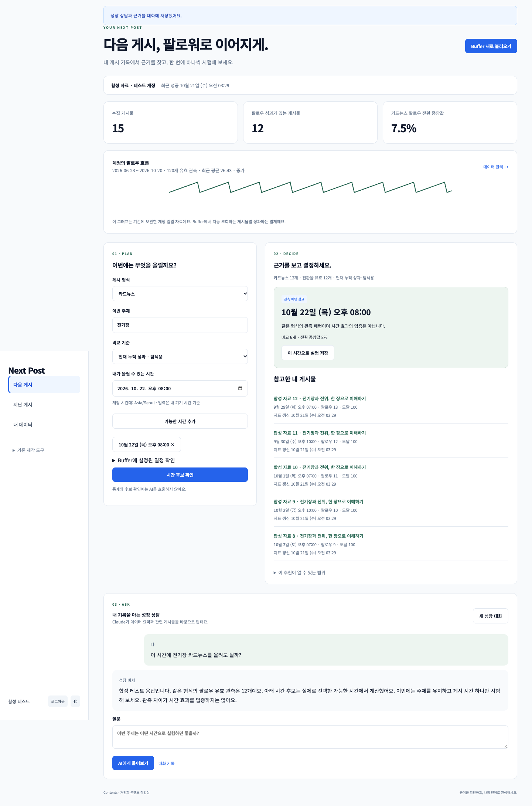

# Next Post · 내 Instagram을 아는 AI 비서

Buffer에 연결된 내 Instagram 게시물과 일별 데이터를 바탕으로 **게시물 검색, 초안 비교, 후속 콘텐츠 기획**을 돕는 개인 웹 서비스입니다. 읽은 이미지 본문과 데이터 요약을 AI에 전달하고, 답변과 참고 자료를 대화 기록으로 저장합니다.

**[서비스 접속](https://m1-2-frontend-theta.vercel.app/) · [백엔드 상태](https://m1-2-6ae7.onrender.com/health) · [Swagger API 문서](https://m1-2-6ae7.onrender.com/docs)**

Google 로그인 후 허용된 사용자만 개인 자료에 접근합니다. Swagger에서도 보호된 API를 실행하려면 Firebase ID 토큰이 필요합니다.

## 1. 주요 기능과 사용 순서

1. **Instagram 대화:** Buffer 자료를 불러온 뒤 질문합니다. 기존 게시물 찾기, 새 이미지 초안 비교, 기존 글 재활용을 한 대화창에서 요청할 수 있습니다. 답변 생성 중 로딩을 표시합니다.
2. **지난 게시:** 게시물·성과를 확인하고 대화에 참고할 글을 선택합니다. 이미지 본문은 최대 10장을 읽어 저장하고, 같은 출처는 재사용합니다. 영상 본문은 읽지 않습니다.
3. **내 데이터:** `직접 기록`에서 날짜·지표·값·메모를 추가·수정·삭제합니다. 저장 후 목록과 요약을 다시 조회합니다. 가져온 원본 자료는 읽기 전용입니다.
4. **대화 기록:** 저장된 대화의 `불러오기`를 누르면 질문·답변·작업 결과·당시 참고 자료를 복원합니다.

시계열 분석에는 M1-1의 **139일 기록**을 사용합니다. Buffer 게시물 성과는 별도로 수집하며, 계정 일별 수치를 특정 게시물의 성과로 나누어 해석하지 않습니다.

## 2. 기술과 구조

**백엔드:** Python 3.10+, FastAPI, Pydantic, firebase-admin, python-dotenv, OpenAI·Anthropic SDK

**프론트:** HTML·CSS·JavaScript, Firebase Google 로그인

**저장·배포:** Firestore · Render API · Vercel 정적 웹

```text
브라우저 → Firebase 로그인 → FastAPI 사용자 확인
                         ├ 일별 데이터 → 통계 요약 → 시스템 프롬프트
                         ├ Buffer 게시물 → 관련 본문·캡션 → AI 참고 자료
                         └ AI 답변 → Firestore 자동 저장 → 대화 불러오기
```

1. **라우터 / 서비스 / 저장소 분리:** `routes/`는 URL·HTTP 응답·인증, 서비스는 채팅·수집·저장 흐름, `analytics.py`는 통계 계산, `store.py`는 Firestore 접근을 담당합니다. 계산을 외부 연결과 분리해 같은 요약을 API와 채팅에서 재사용하고 독립적으로 검사합니다.
2. **Pydantic 검증:** 날짜·지표 종류·음수가 아닌 정수·메모 길이·기간 순서·이미지 개수와 형식을 API 진입 시 검사합니다. 알 수 없는 필드를 거부하고, AI 응답도 스키마와 실제 참고 ID를 검증한 뒤 저장합니다.
3. **화면 상태:** 로그인 후 자료를 조회하고, 데이터 저장 후 목록·요약을 갱신합니다. 채팅은 `입력 → 로딩 → 응답 저장 → 메시지 표시`, 불러오기는 `목록 → 상세 조회 → 메시지 복원` 순서입니다. 응답이 끊기면 입력과 요청 ID를 유지해 저장 상태를 확인합니다.

### Firestore 저장 구조

```text
data/{id}                         날짜·지표·값·메모·출처·owner_uid
conversations/{id}                제목·메시지 수·갱신 시각·owner_uid
  └ messages/{id}                  순서·역할·본문·작업 결과·참고 자료
requests/{id}                     채팅 처리 상태·저장된 응답
buffer_syncs/{id}/posts/{id}       수집 시점의 원본 게시물·성과
post_readings/{id}                이미지 판독문·요약·출처 서명
```

`data`는 사용자·날짜·지표 조합으로 중복을 막고 기간별 집계를 쉽게 합니다. 대화 목록용 정보와 개별 메시지는 분리해 목록 조회에서 전체 본문을 읽지 않도록 했습니다. 메시지 순서와 당시 근거를 함께 저장해 불러온 답변의 맥락을 유지합니다.

## 3. 핵심 설계 이유

1. **컨텍스트 주입:** `/api/data/summary`와 채팅이 같은 `summarize()`를 사용합니다. 기간·평균·최대·최소·전기 대비 추세를 계산해 시스템 프롬프트의 `[사용자 데이터 요약]`에 넣습니다. 사용자가 데이터를 다시 설명할 필요가 줄지만, 요약에서 빠진 정보나 인과관계를 AI가 알아내는 것은 아닙니다. 캡션·판독문·과거 대화는 별도의 참고 입력으로 전달합니다.
2. **요약 API 분리:** 화면 표시와 AI 입력이 같은 계산 기준을 사용합니다. 기본은 **저장된 최신 날짜까지 7일**과 직전 7일을 비교하며 `start`, `end`로 기간을 지정할 수 있습니다. 기본을 최근 30일로 바꾸려면 `backend/app/analytics.py`의 기본 기간을 30일로 변경하고 기간 관련 검사를 갱신합니다.
3. **대화 자동 저장:** AI 응답 검증 후 질문·답변·근거와 대화 메타데이터를 한 트랜잭션으로 저장합니다. 같은 요청 ID는 기존 결과를 반환하므로 재시도로 중복 생성하는 일을 줄입니다. 이전 작업 원문도 후속 질문에 전달합니다.
4. **환경 변수:** 비밀 키를 소스에서 분리하고 로컬·운영 주소를 각각 적용합니다. 서버는 `.env` 또는 Render 환경 변수, 프론트는 Vercel 빌드 환경 변수를 사용합니다. 프론트에는 API 주소와 공개 Firebase 웹 설정만 포함합니다.

## 4. 실행과 배포

Python 3.10+와 Node.js 22+를 준비한 뒤 저장소 루트에서 실행합니다.

```bash
python3 -m venv .venv
source .venv/bin/activate
pip install -r backend/requirements.lock
cp .env.example .env
# .env에 서버 환경 변수 입력
uvicorn app.main:app --app-dir backend --reload --port 8000
```

다른 터미널에서 프론트를 실행합니다.

```bash
cp frontend/.env.example frontend/.env.local
# API_BASE_URL과 공개 Firebase 웹 설정 입력
node --env-file=frontend/.env.local frontend/build-config.mjs
python3 -m http.server 3000 --directory frontend/public
```

[로컬 화면](http://localhost:3000) · [로컬 Swagger](http://localhost:8000/docs)

### 환경 변수

- **인증·DB:** `FIREBASE_SERVICE_ACCOUNT_JSON`, `ALLOWED_USER_UIDS`.
- **AI:** `LLM_PROVIDER=openai`일 때 `OPENAI_API_KEY`, `OPENAI_MODEL`. `anthropic`일 때 `ANTHROPIC_API_KEY`, `ANTHROPIC_MODEL`, 선택 `ANTHROPIC_BASE_URL`.
- **Instagram 수집:** `BUFFER_API_KEY`, `BUFFER_CHANNEL_ID`, `BUFFER_OWNER_UID`. 개인 읽기 키를 서버에만 저장합니다.
- **서버 CORS:** `ALLOWED_ORIGINS`에 허용할 프론트 주소를 쉼표로 구분합니다. 로컬 예: `http://localhost:3000`.
- **프론트:** `API_BASE_URL`, `FIREBASE_WEB_CONFIG`. 서비스 계정이나 AI·Buffer 키는 넣지 않습니다.
- **호출 제한:** `MAX_OUTPUT_TOKENS`, `DAILY_REQUEST_LIMIT`. 본문 판독과 대화가 같은 사용자별 일일 AI 한도를 사용합니다.

Firebase에서 Google 로그인을 켜고 Authorized domains에 `localhost`와 배포 도메인을 등록합니다. Firestore를 만든 뒤 [firestore.rules](firestore.rules)를 적용하고 허용 UID를 설정합니다.

**Render:** Root `backend`, Build `pip install -r requirements.lock`, Start `uvicorn app.main:app --host 0.0.0.0 --port $PORT`.

**Vercel:** Root `frontend`, Build `node build-config.mjs`, Output `public`. 배포 주소를 서버의 `ALLOWED_ORIGINS`에도 등록합니다.

### 필수 API

- 데이터: `POST/GET /api/data`, `PUT/DELETE /api/data/{id}`, `GET /api/data/summary`.
- 대화: `POST/GET /api/conversations`, `GET/DELETE /api/conversations/{id}`.
- AI 채팅: `POST /api/chat`. 요청 ID별 상태 조회는 `GET /api/chat/requests/{request_id}`.

대화 목록에는 전체 메시지가 없으며, 상세 조회가 전체 `messages`를 반환합니다. 세부 요청·응답 형식은 [Swagger](https://m1-2-6ae7.onrender.com/docs)에서 확인합니다.

## 5. 운영과 안전

1. **콜드스타트:** 첫 요청이 길어지면 서버 시작 안내를 띄웁니다. 입력을 보존하고 요청 ID로 완료 여부를 확인해 무작정 다시 생성하지 않게 합니다.
2. **CORS:** Vercel과 Render의 출처가 달라 브라우저가 API 응답을 제한합니다. 허용한 정확한 origin·메서드·헤더를 FastAPI에 설정하고 오류 응답에도 적용합니다. Firebase Authorized domains는 로그인 허용 설정으로 별도 관리합니다.
3. **입력·자료 보호:** 모든 API에서 Firebase 토큰과 소유 UID를 확인합니다. Firestore의 브라우저 직접 접근은 차단하며 Admin SDK를 쓰는 서버에서도 소유권을 검사합니다. 참고 글의 명령을 시스템 지시로 취급하지 않고, 출력은 HTML로 실행하지 않습니다. 이미지의 실제 형식·해시·크기와 서버 다운로드 주소도 검사합니다.
4. **장애·확장:** DB 한도 초과는 원인을 안내하고 반복 읽기는 캐시로 줄입니다. 현재는 사용자별 최대 10,000개 자료를 조회한 뒤 집계하므로, 데이터가 커지면 `store.py`의 조회를 인덱스·기간 조건·페이지네이션으로 바꾸고 서비스가 필요한 범위만 요청하도록 확장해야 합니다.

## 6. 평가 확인과 검증 범위

1. 배포 URL과 `/docs` 접속 → Google 로그인 → `내 데이터`의 `직접 기록` 추가 → 목록 반영·Firestore 저장 확인.
2. 데이터 수정·삭제 → `/api/data/summary` 확인 → 기간 평균·최대값을 질문해 답변에 요약이 반영되는지 확인.
3. 대화 목록에서 `불러오기` → 질문·답변·근거 복원 → 새로고침 후 유지 여부 확인.
4. 작은 화면에서 메뉴·채팅·데이터 입력·불러오기를 확인.

**확인한 범위:** 백엔드 테스트 165개, 빌드 설정 3개, 새 대화 브라우저 시나리오 6개, 기존 성장 회귀 9개 및 통합 흐름을 통과했습니다. 운영에서 게시물 조회·저장된 본문 재사용·실제 AI 답변과 대화 저장을 확인했습니다. 상세 근거는 [검증 기록](docs/verification.md)에 있습니다.

**현재 AI 연결:** 실제 연동 검증은 Anthropic 호환 API로 수행했습니다. OpenAI 경로는 구현·전송 테스트를 마쳤으나 실제 호출은 별도 확인이 필요합니다. 이를 과제의 GPT API 실호출로 표기하지 않습니다.

**보너스 과제는 미수행·미제출입니다.** 아래 화면은 합성 자료로 검증한 기능 예시이며 실제 계정 성과를 공개한 자료가 아닙니다.

<details>
<summary>제출 화면: 채팅 · 데이터 관리 · 대화 불러오기</summary>




</details>

```bash
pip install -r backend/requirements-dev.txt
pytest -q
pnpm install --frozen-lockfile
pnpm test:build
```

브라우저 검증 실행 방법과 추가 설계 설명은 [검증 기록](docs/verification.md) · [구조 문서](docs/architecture.md)를 참고합니다.
