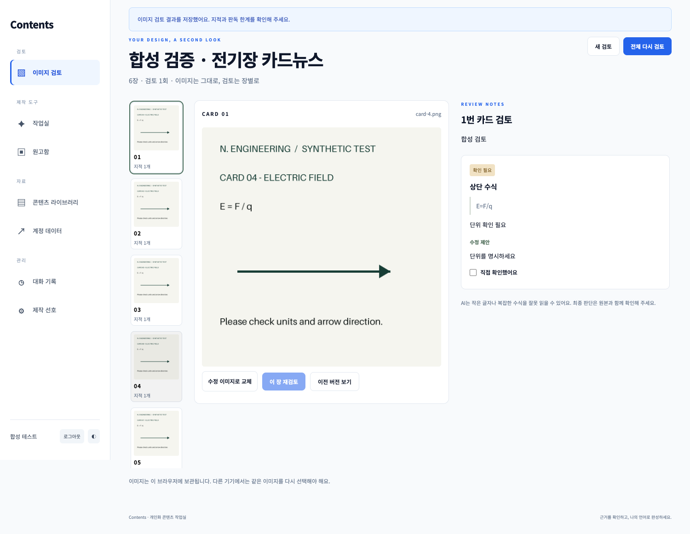
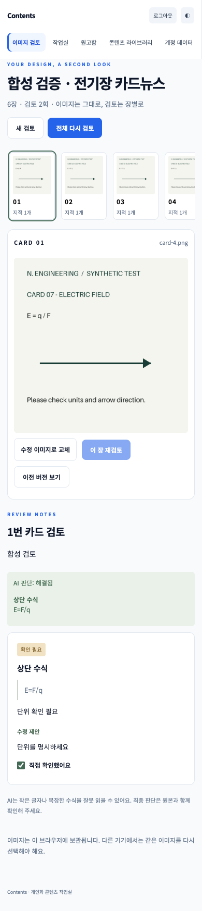
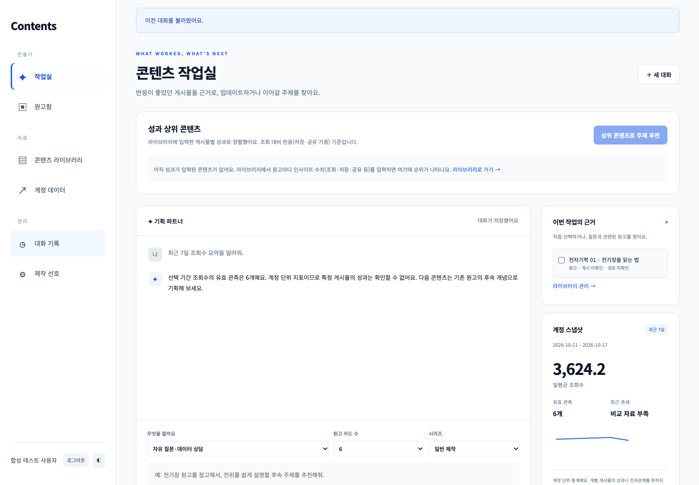

# Contents · 카드뉴스 이미지 검토 비서

완성한 카드뉴스 이미지를 여러 장 올리면 **각 장의 수식·개념·도식 오류와 확인할 부분**을 정리해 주는 개인 AI 비서입니다. 원본 이미지를 다시 생성하지 않고, 고친 이미지 한 장만 교체해 이전 지적이 해결됐는지 재검토합니다.

## 사용하는 순서

1. Google 로그인 후 **이미지 검토**에서 PNG·JPEG·WebP 정지 이미지 1~10장을 선택합니다. 원본 한 장은 10MB·4천만 화소 이하입니다.
2. 썸네일에서 순서를 확인합니다. 필요하면 **앞으로 / 뒤로**로 옮기고 검토 제목을 입력합니다.
3. ‘부호와 단위를 특히 봐줘’처럼 이번 기준을 적고 **전체 검토**를 누릅니다. 기본 검토 기준은 명시적으로 선택한 경우에만 같은 브라우저에서 재사용합니다.
4. 왼쪽에서 카드를 고르면 가운데 카드 이미지와 오른쪽 검토 결과가 함께 표시됩니다. 이미지는 눌러 확대할 수 있습니다.
5. 외부 제작 도구에서 고친 이미지를 **수정 이미지로 교체**한 뒤 **이 장 재검토**를 누릅니다. 다른 장의 결과는 유지됩니다.
6. AI의 해결 판단과 별도로 **직접 확인했어요**를 체크합니다. **이전 버전 보기**로 과거 결과도 확인할 수 있습니다.

장 사이 기호·설명·디자인 일관성은 **전체 카드 연결 검토**에 표시합니다. 한 장이 바뀌면 이 결과는 갱신 필요 상태가 되며, 전체 검토를 다시 실행해야 갱신됩니다.

### 결과를 읽는 법

| 표시 | 의미 |
| --- | --- |
| 수정 필요 | 이미지에서 구체적으로 확인되는 모순·오류 |
| 확인 필요 | 흐릿한 수식, 조건 누락, 판단 근거 부족 등 직접 확인할 부분 |
| 표현 개선 | 가독성·표기·디자인 일관성 개선 제안 |

각 지적에 위치·인용, 이유, 수정 제안이 붙습니다. 지적 없음은 정확성 보증이 아닙니다. 작은 글자와 복잡한 수식·도식은 잘못 읽을 수 있으므로 게시 전 원본과 함께 확인하세요. 자동 이미지 수정·자동 게시는 제공하지 않습니다.



## 구현과 배포 상태

- 이 브랜치의 이미지 검토 기능은 로컬에서 구현·검증한 변경입니다. **기존 운영 URL에 반영됐다는 뜻이 아닙니다.** main 병합·운영 배포는 별도입니다.
- 이번 실제 모델 확인: 현재 설정된 Anthropic 호환 API의 `claude-sonnet-4`에 합성 이미지 2장을 전달했습니다. 모델이 카드 번호와 수식을 읽고 `E = q/F` 오류 및 장 사이 모순을 지적했습니다. 이 소수 사례로 일반적인 정확도를 주장하지 않습니다.
- OpenAI 이미지 입력·구조화 응답은 구현했고 실제 SDK의 HTTP 전송 테스트를 통과했습니다. **이번 변경의 실제 OpenAI 호출은 검증하지 않았습니다.** 원래 과제의 GPT API 사용 요건을 제출하려면 OpenAI 설정으로 실제 호출도 확인해야 합니다.
- 기존 운영 주소: [프론트](https://m1-2-frontend-theta.vercel.app/) · [백엔드](https://m1-2-6ae7.onrender.com/) · [Swagger](https://m1-2-6ae7.onrender.com/docs)

검증 범위와 실행 결과는 [검증 기록](docs/verification.md)에 있습니다.

## 이미지와 검토 결과 보관

**이미지 원본·검토용 이미지**는 계정 UID별로 분리해 브라우저 IndexedDB에 보관합니다. 검토할 때만 현재 설정된 AI 제공업체로 전송하며, Firestore나 Git에는 이미지 base64를 저장하지 않습니다. 검토용 이미지는 긴 변 2,400px 이하·1MB 이하로 준비하며 원본과 다르게 보일 수 있습니다. 애니메이션·손상 파일·위장 형식은 거부합니다.

**검토 제목·파일명·이미지 해시·기준·장별 결과·버전·사용자 체크**는 Firestore에 저장합니다. Google 로그인이 같아도 다른 기기에서는 이미지가 자동으로 따라오지 않습니다. 브라우저 저장소를 지웠을 때도 같은 파일을 다시 선택해야 합니다. 과거 이미지와 다른 파일은 과거 결과에 연결하지 않습니다. 원본 파일은 별도로 보관하세요. 브라우저별 재인코딩 차이로 같은 원본의 검토용 해시가 달라지는 경우는 검증하지 않았으며, 해시가 다르면 자동 연결하지 않습니다. 확대 화면도 검토용 이미지입니다.

브라우저 저장 실패는 AI 요청 전에 알립니다. 응답이 끊기면 **검토 상태 확인**으로 저장된 결과를 복구하고, 서버에 요청이 도달하지 않았으면 **같은 요청 재시도**를 사용합니다. 새 요청 UUID로 다시 검토하면 새 모델 호출이며 사용량에 포함됩니다. 이미지 검토·채팅·원고 검토는 공통 일일 요청 한도를 사용합니다.

## 기술과 구조

- 백엔드: Python 3.10+, FastAPI, Pydantic, firebase-admin, Pillow, OpenAI SDK, Anthropic SDK, python-dotenv
- 프론트: HTML / CSS / JavaScript, IndexedDB, Firebase Authentication. UI 프레임워크 없음
- 데이터베이스: Firebase Firestore. 브라우저 직접 DB 접근은 차단하고 서버가 모든 문서의 소유권을 검사
- 배포: 백엔드 Render / 정적 프론트 Vercel

```text
이미지 선택 → 브라우저 검증·보관 → FastAPI 인증·크기·해시 검사
 → 요청 예약·일일 한도 확인 → 이미지 지원 모델에 검토 요청
 → 응답 구조·장 ID·이전 지적 ID 검증 → Firestore 결과·버전 저장
 → 카드 이미지 옆에 검토 결과 표시
```

```text
backend/app/
  image_assets.py             실제 이미지 디코딩·형식·해시·크기 검사
  image_review_models.py      입력과 모델 응답의 Pydantic 스키마
  image_review_generation.py  OpenAI / Anthropic 멀티모달 전송
  image_review_service.py     소유권·버전·예약·한도·저장·복구
  image_review_limits.py      16MB 요청 본문 제한
  routes/image_reviews.py     이미지 검토 API
  analytics.py                기존 시계열 통계 계산
  generation.py               데이터 요약을 주입한 기존 채팅
  store.py, repository.py     Firestore 어댑터와 소유권 검사
frontend/
  image-review.js             업로드·장별 결과·교체·재검토 화면
  review-images.js            이미지 준비·UID별 IndexedDB 보관
  image-review.css            반응형 검토 화면
  app.js, auth.js, api.js     기존 앱·로그인·통신 연결
```

새 컬렉션은 `image_reviews`, `image_review_versions`, `image_review_requests`입니다. 이미지 안의 문구와 사용자 검토 기준은 신뢰하지 않는 참고 자료로 전달하고 시스템 지시로 취급하지 않습니다. 모델 호출 동안 Firestore 트랜잭션을 열지 않습니다. 요청 UUID로 중복 호출을 막고 기준 버전이 오래됐으면 409로 차단합니다.

[설계서](docs/superpowers/specs/2026-10-19-image-review-design.md) · [구현 계획](docs/superpowers/plans/2026-10-19-image-review.md)

## 로컬 실행

Python 3.10+와 Node.js 22+가 필요합니다. 저장소 루트에서 실행합니다.

```bash
python3 -m venv .venv
source .venv/bin/activate
pip install -r backend/requirements.lock
cp .env.example .env
# .env에 Firebase 서비스 계정, 허용 UID, 모델 키와 CORS 설정 입력
uvicorn app.main:app --app-dir backend --reload --port 8000
```

다른 터미널에서:

```bash
cp frontend/.env.example frontend/.env.local
# API_BASE_URL과 공개 FIREBASE_WEB_CONFIG 입력
node --env-file=frontend/.env.local frontend/build-config.mjs
python3 -m http.server 3000 --directory frontend/public
```

[로컬 화면](http://localhost:3000) · [로컬 Swagger](http://localhost:8000/docs). `file://`로 HTML을 직접 열지 않습니다. 환경 변수 변경 후 서버 재시작·프론트 재빌드가 필요합니다.

### Firebase 준비

1. Firebase 웹 앱을 만들고 Authentication의 Google 로그인을 활성화합니다.
2. Authorized domains에 `localhost`와 사용할 Vercel 호스트를 등록합니다.
3. Firestore를 만들고 [firestore.rules](firestore.rules)를 적용합니다. 서버 Admin SDK는 규칙을 우회하므로 API의 소유권 검사도 유지해야 합니다.
4. 서비스 계정 JSON을 백엔드 환경 변수에 넣고, Firebase **공개 웹 설정**을 프론트 빌드에 넣습니다. 두 설정은 서로 다릅니다.
5. Google 로그인 계정의 Firebase UID를 `ALLOWED_USER_UIDS`에 등록합니다. 등록 전 403은 정상적인 접근 제한입니다.

### 환경 변수

| 위치 | 변수 | 용도 |
| --- | --- | --- |
| 백엔드 | `FIREBASE_SERVICE_ACCOUNT_JSON` | 서비스 계정 JSON. 키 값은 Git·채팅에 올리지 않음 |
| 백엔드 | `ALLOWED_USER_UIDS` | 허용 Firebase UID, 쉼표 구분. 비어 있으면 모두 차단 |
| 백엔드 | `ALLOWED_ORIGINS` | 정확한 프론트 origin. 로컬 기본 `http://localhost:3000` |
| 백엔드 | `LLM_PROVIDER` | `openai` 또는 `anthropic` |
| 백엔드 | `OPENAI_API_KEY`, `OPENAI_MODEL` | 이미지 입력·구조화 출력을 지원하는, 계정에서 사용 가능한 실제 모델 ID |
| 백엔드 | `ANTHROPIC_API_KEY`, `ANTHROPIC_MODEL` | Anthropic 또는 호환 게이트웨이 키·모델 ID |
| 백엔드 | `ANTHROPIC_BASE_URL` | 호환 게이트웨이 주소. 비우면 SDK 기본값 |
| 백엔드 | `MAX_OUTPUT_TOKENS` | 256~8000, 기본 4000. 여러 장의 자세한 검토에는 8000으로 시작하고 비용·응답 길이 확인 |
| 백엔드 | `DAILY_REQUEST_LIMIT` | 사용자별 일일 모델 호출 시도 한도, 기본 30, UTC 자정 초기화 |
| 프론트 빌드 | `API_BASE_URL` | 백엔드 주소. 브라우저에 공개됨 |
| 프론트 빌드 | `FIREBASE_WEB_CONFIG` | 공개 Firebase 웹 설정 JSON. 서비스 계정 JSON을 넣으면 안 됨 |

선택한 제공업체의 키만 필요합니다. 모델은 이미지 입력과 해당 구조화 응답 방식을 모두 지원해야 합니다. Anthropic 경로는 스트리밍과 강제 도구 호출을 사용합니다. 출력이 잘리거나 스키마를 만족하지 않으면 성공으로 저장하지 않습니다. 자동으로 다른 제공업체로 전환하지 않습니다.

`python-dotenv`는 이미 셸에 있는 환경 변수를 덮어쓰지 않습니다. 셸의 게이트웨이 주소가 의도와 다르면 `env -u ANTHROPIC_BASE_URL uvicorn ...`처럼 기존 값을 비우고 실행합니다. API 사용은 비용이 발생할 수 있으므로 처음에는 합성 이미지 1~2장으로 검증합니다.

## API

모든 `/api` 요청에는 `Authorization: Bearer <Firebase ID token>`이 필요합니다. 자세한 스키마는 `/docs`에서 확인합니다.

| 메서드 | 경로 | 역할 |
| --- | --- | --- |
| POST / GET | `/api/image-reviews` | 검토 작업 생성 / 최근 목록 |
| GET | `/api/image-reviews/{id}` | 현재 장별 결과·메타데이터 |
| POST | `/api/image-reviews/{id}/runs` | 전체 검토 또는 한 장 재검토 |
| GET | `/api/image-reviews/{id}/runs/{request_id}` | 지연·응답 유실 시 결과 상태 확인 |
| GET | `/api/image-reviews/{id}/cards/{card_id}/versions` | 장별 이전 결과 |
| PUT | `/api/image-reviews/{id}/checks/{finding_id}` | 사용자 직접 확인 체크 |

실행 요청의 `images`에는 전체 카드의 현재 이미지를 포함합니다. 한 장 재검토에서는 `target_card_id`와 해당 장의 `previous_image`도 포함하고, 다른 장의 해시는 저장된 현재 버전과 일치해야 합니다. 요청 전체는 16MB 이하입니다. 목록 응답에는 이미지와 전체 검토 결과를 포함하지 않습니다.

## 기존 기능과 과제 요건

이미지 검토 외에 기존 기능도 유지합니다.

- **제작 도구 / 작업실·원고함:** 원고·JSON 가져오기, 선택 카드·항목 교정, 수정안 비교·선택 반영, 이력 복원, 1080×1080 PNG·ZIP·JSON·Markdown 내보내기
- **콘텐츠 라이브러리 / 제작 선호:** 원고·성과·시리즈 규칙 관리
- **계정 데이터:** `(date, value, memo)`와 지표 종류의 CRUD, 그래프, 0과 결측 분리, 이전 기간 대비 요약
- **기획·데이터 상담 / 대화 기록:** 서버에서 계산한 시계열 요약을 시스템 프롬프트에 넣고 AI 답변·대화를 저장하고 불러오기

필수 API: `POST/GET /api/data`, `PUT/DELETE /api/data/{id}`, `GET /api/data/summary`, `POST /api/chat`, `POST/GET /api/conversations`, `GET/DELETE /api/conversations/{id}`.

`/api/chat`은 summary API와 같은 Python `summarize()` 함수를 사용하고 결과를 `[사용자 데이터 요약]` 블록으로 주입합니다. 모델에게 통계를 계산하거나 Firestore를 직접 읽게 하지 않습니다. 대화 목록에는 messages가 없고 단건 상세에는 시간순 messages가 있습니다.

[M1-1](https://github.com/gaori2952/M1-1)의 시계열은 계정 전체 지표이며 특정 게시물의 성공 원인·인과를 증명하지 않습니다. 개인 CSV와 GPT 대화 원문은 공개 저장소에 포함하지 않습니다. 과제의 최소 100개 포인트는 본인 자료를 가져와 충족해야 하며, 테스트 서버의 120일 자료는 합성 데이터입니다. 이미지 검토만으로 시계열 분석 요건을 충족한다고 주장하지 않습니다.

```bash
# 검증만: 클라우드 저장 없음
PYTHONPATH=backend python -m scripts.import_sources --kind metrics --file .private/daily.csv --uid YOUR_FIREBASE_UID --dry-run
# 본인 자료 검증 후 저장
PYTHONPATH=backend python -m scripts.import_sources --kind metrics --file .private/daily.csv --uid YOUR_FIREBASE_UID --apply
```

## 테스트

```bash
source .venv/bin/activate
pip install -r backend/requirements-dev.txt
python -m pytest backend/tests -q
ruff check backend
ruff format --check backend
corepack enable
pnpm install --frozen-lockfile
node --test tests/build.test.mjs
pnpm exec prettier --check frontend/*.js frontend/*.mjs frontend/*.html frontend/*.css tests/e2e/*.mjs
```

브라우저 테스트는 별도 터미널에서 테스트 서버를 시작합니다. 운영 앱으로 배포하지 않습니다.

```bash
# 터미널 1: 메모리 저장소·목 모델·합성 자료
PYTHONPATH=backend python -m uvicorn tests.preview:app --host 127.0.0.1 --port 18100
# 터미널 2
API_BASE_URL=http://127.0.0.1:18100 node frontend/build-config.mjs
python -m http.server 18101 --bind 127.0.0.1 --directory frontend/public
# 터미널 3
pnpm exec playwright install chromium
pnpm test:image-review
pnpm test:image-review-regressions
pnpm test:e2e
pnpm test:durability
pnpm test:editor
pnpm test:editor-regressions
```

설치된 Chrome을 쓰려면 `CHROME_PATH`를 실행 파일 경로로 지정합니다. 이미지 E2E는 `.venv/bin/python`과 Pillow로 합성 카드를 만듭니다. 기존 durability 테스트는 flow가 만든 자료를 사용하므로 순서를 지킵니다. 브라우저 테스트는 임시 브라우저에서 인증 모듈만 대체하며 운영 인증을 우회하는 플래그는 없습니다.

## Render·Vercel 배포

- **Render:** Root `backend`, Build `pip install -r requirements.lock`, Start `uvicorn app.main:app --host 0.0.0.0 --port $PORT`. [render.yaml](render.yaml) 참고. 백엔드 키·허용 UID·CORS를 환경 변수로 설정합니다.
- **Vercel:** Root `frontend`, Framework `Other`, Build `node build-config.mjs`, Output `public`. 공개 `API_BASE_URL`·`FIREBASE_WEB_CONFIG` 설정이 필요합니다.
- 배포 후 Render의 `ALLOWED_ORIGINS`와 Firebase Authorized domains에 실제 프론트 주소를 등록합니다.
- Render 무료 인스턴스의 첫 요청은 50초 이상 걸릴 수 있습니다. 화면은 대기 안내를 표시하며 응답 유실 시 요청 상태를 조회합니다.
- `/health`의 `configured`는 환경 변수 존재 여부이며 실제 모델·Firestore 연결 성공을 보증하지 않습니다.
- main 병합 후 두 플랫폼 모두 같은 변경이 배포됐는지 Swagger와 브라우저에서 확인합니다. 이 브랜치를 push하는 것만으로 기존 운영 서비스가 갱신되지는 않습니다.

## 제출 화면

아래는 합성 자료·목 모델의 동작 예시입니다. 실제 사용자 이미지와 실제 모델 응답을 포함하지 않습니다.



과제의 데이터 요약·질문과 답변, 데이터 관리, 대화 불러오기 화면은 다음과 같습니다.



