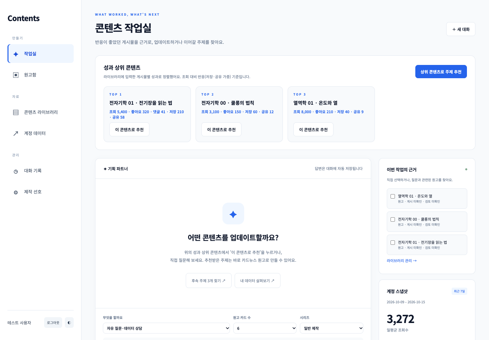
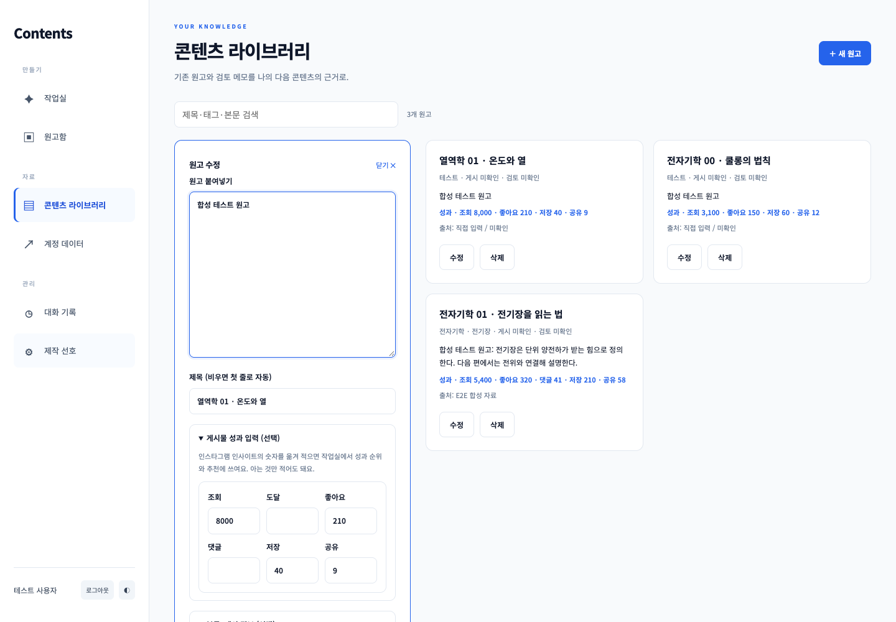
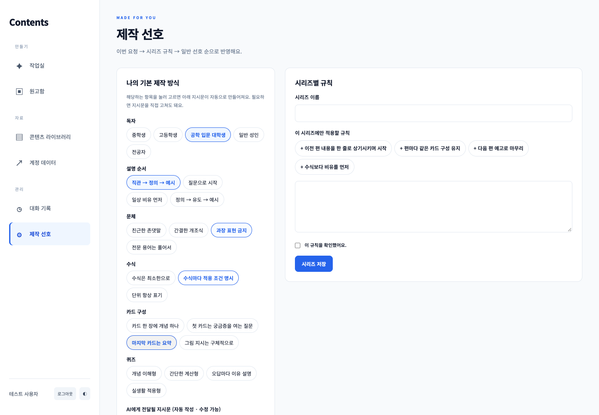

# Contents · 성과에서 시작하는 콘텐츠 제작 작업실

반응이 좋았던 게시물과 내가 확인한 제작 기준을 근거로 **업데이트·후속 주제 추천 → 카드뉴스 원고 → 퀴즈 → 수정·보관**을 한 흐름으로 잇는 개인 AI 작업실입니다.
게시물별 성과는 사용자가 인사이트에서 옮겨 적은 수치를 쓰고, [M1-1](https://github.com/gaori2952/M1-1)의 계정 일별 시계열은 계정 상황을 이해하는 보조 근거로만 씁니다. 지표의 원인을 단정하지 않습니다.

## 현재 상태

로컬에서 **실제 Firebase(인증·Firestore)와 Anthropic 호환 게이트웨이(COPA, `claude-sonnet-4`)에 연결해 검증**했습니다. Render·Vercel 배포는 아직 하지 않았습니다.

- 프론트 URL: (로컬: http://localhost:3000)
- 백엔드 API URL: (로컬: http://localhost:8000)
- Swagger URL:  (로컬: http://localhost:8000/docs)

[아키텍처](docs/architecture.md) · [구현 계획](docs/implementation-plan.md) · [검증 결과와 제한](docs/verification.md)

## 화면 구성

| 메뉴 | 하는 일 |
| --- | --- |
| **작업실** | 성과 상위 콘텐츠 TOP 3를 보여주고, 그 수치를 근거로 업데이트·후속 주제 3개를 추천받아 바로 카드뉴스 원고로 만듭니다. 자유 질문·데이터 상담도 가능합니다. |
| **원고함** | 생성한 원고를 열어 카드·수식·퀴즈를 다듬고, 직접 검토 완료 표시 후 JSON·Markdown으로 내려받습니다. |
| **콘텐츠 라이브러리** | 원고를 붙여넣기만 하면 첫 줄이 제목이 됩니다. 게시물 성과(조회·도달·좋아요·댓글·저장·공유)와 분류 정보는 필요할 때만 펼쳐 입력합니다. 검색 지원. |
| **계정 데이터** | 계정 일별 지표 조회·추가·수정. 최근 7일·30일·90일·전체 빠른 기간, 0과 결측 구분, 이전 동일 기간 비교. |
| **대화 기록** | 저장된 대화를 불러오거나 삭제합니다. |
| **제작 선호** | 독자·설명 순서·문체·수식·카드 구성·퀴즈 항목을 눌러 고르면 지시문이 자동 작성됩니다. 시리즈별 규칙은 자주 쓰는 문구 버튼으로 채웁니다. 확인 후 저장한 내용만 적용됩니다. |

## 구현한 기능

- Google 로그인 + 허용 UID 검사, 모든 데이터 소유권 검사, 브라우저의 Firestore 직접 접근 차단
- 게시물별 성과 입력과 성과 순위(조회 대비 반응, 저장·공유 가중), 성과 근거를 밝히는 추천 프롬프트
- 시계열 CRUD, 유효 관측·결측 분리, 이전 동일 기간과 비교하는 요약
- 원고 라이브러리 CRUD, 선택 원고 또는 키워드 검색(최대 5개, 원고당 12,000자)
- 일반 선호와 시리즈별 규칙의 명시적 확인·저장(수정 기록이 자동으로 선호가 되지 않음)
- 후속 후보 정확히 3개, 카드 4~10장과 4지선다 퀴즈, 사람이 확인할 review_items
- 응답 구조·근거 ID 검사, request_id 중복 방지, 대화별 동시 생성 차단, 일일 요청 한도
- 저장 결과가 불확실할 때 같은 request_id로 복구, 미저장 원고 보호, 저장 중 편집 잠금, 원고 버전 충돌 방지
- 생성 제공자 선택: OpenAI(Responses API 구조화 출력) 또는 Anthropic 호환(스트리밍 + 강제 도구 호출)
- 반응형 바닐라 화면, 다크 모드, 그래프, JSON/Markdown 다운로드, 빌드마다 자산 버전 해시

## 기술 스택

Python 3.10+ / FastAPI / Pydantic / firebase-admin / OpenAI Python SDK 또는 Anthropic Python SDK / python-dotenv.
프론트는 HTML·CSS·JavaScript와 Firebase Auth 웹 SDK이며 UI 프레임워크를 사용하지 않습니다.
배포 대상은 백엔드 Render, 프론트 Vercel입니다.

## 로컬 실행

Python 3.10+와 Node.js 22+가 필요합니다. 저장소 루트에서 실행하세요.

```bash
python3 -m venv .venv
source .venv/bin/activate
pip install -r backend/requirements.lock
cp .env.example .env
# .env에 백엔드 설정 입력
uvicorn app.main:app --app-dir backend --reload --port 8000
```

> Claude Code 터미널처럼 셸에 `ANTHROPIC_BASE_URL`이 이미 설정된 환경에서는 그 값이 `.env`보다 우선합니다(python-dotenv 기본 동작).
> 게이트웨이를 쓸 때는 `env -u ANTHROPIC_BASE_URL uvicorn app.main:app --app-dir backend --port 8000`처럼 비우고 실행하세요.

다른 터미널에서:

```bash
cp frontend/.env.example frontend/.env.local
# frontend/.env.local에 공개 Firebase 웹 설정 입력
node --env-file=frontend/.env.local frontend/build-config.mjs
python3 -m http.server 3000 --directory frontend/public
```

http://localhost:3000 접속. `file://`로 HTML을 직접 열지 마세요.
환경 변수 변경 후 백엔드를 재시작하고 프론트를 다시 빌드하세요.

## Firebase / 생성 모델 준비

1. Firebase 콘솔에서 프로젝트와 웹 앱을 생성합니다.
2. Authentication → Sign-in method에서 Google을 활성화합니다. Authorized domains에 `localhost`와 실제 Vercel 도메인을 등록합니다.
3. Firestore Database를 생성하고 [firestore.rules](firestore.rules)를 적용합니다. 브라우저 직접 DB 접근은 거부하고 백엔드에서만 접근합니다.
4. Project settings → Service accounts에서 서비스 계정 JSON을 준비합니다. 파일 내용을 `.env`의 `FIREBASE_SERVICE_ACCOUNT_JSON`에 단일 줄 JSON으로 넣습니다. 예: `FIREBASE_SERVICE_ACCOUNT_JSON='{"type":"service_account",...}'`. 키 파일이나 실제 값은 Git·채팅에 올리지 마세요.
5. 웹 앱의 Firebase configuration을 `frontend/.env.local`의 `FIREBASE_WEB_CONFIG`에 넣습니다. 이것은 공개 클라이언트 설정이며 서비스 계정 JSON과 다릅니다.
6. 화면에서 Google 로그인 한 번 후 Firebase Authentication 사용자 목록에서 UID를 확인하고 백엔드 `ALLOWED_USER_UIDS`에 입력합니다. 그 전까지 백엔드의 403 응답은 정상적인 접근 제한입니다.
7. 생성 모델을 고릅니다. 기본 `LLM_PROVIDER=openai`는 `OPENAI_API_KEY`와 API 사용 권한이 있는 `OPENAI_MODEL`이 필요합니다(ChatGPT 구독과 API 이용은 별개). Anthropic 호환 게이트웨이(예: COPA)를 쓰려면 `LLM_PROVIDER=anthropic`, `ANTHROPIC_BASE_URL`, `ANTHROPIC_API_KEY`(발급받은 가상 키), `ANTHROPIC_MODEL`을 설정합니다. 이 경로는 강제 도구 호출로 구조화 응답을 받으므로 강제 `tool_choice`를 거부하는 모델(Opus 5.5, Sonnet 5.5, Fable 5.1)은 사용할 수 없습니다.
8. 서버 재시작 후 CRUD부터 확인하고 모델 호출은 후보/원고 각 1회로 작게 시작하세요.

## 환경 변수

| 위치 | 변수 | 설명 |
| --- | --- | --- |
| 백엔드 | LLM_PROVIDER | `openai`(기본) 또는 `anthropic`. 선택한 제공자의 키만 필요 |
| 백엔드 | OPENAI_API_KEY | OpenAI API 키 |
| 백엔드 | OPENAI_MODEL | 기본 `gpt-6.1-sol`; 계정에서 사용할 수 있는 구조화 출력 지원 모델 |
| 백엔드 | ANTHROPIC_API_KEY | Anthropic 또는 호환 게이트웨이 키 |
| 백엔드 | ANTHROPIC_BASE_URL | 호환 게이트웨이 주소. 비우면 SDK 기본값 |
| 백엔드 | ANTHROPIC_MODEL | 기본 `claude-sonnet-4`; 게이트웨이 모델 표의 ID. 한국어 원고가 길어 이 경로에서는 `MAX_OUTPUT_TOKENS=8000` 권장. 셸에 `ANTHROPIC_BASE_URL`이 이미 있으면 `.env`보다 우선하므로 비우고 실행 |
| 백엔드 | FIREBASE_SERVICE_ACCOUNT_JSON | 서비스 계정 JSON 문자열 |
| 백엔드 | ALLOWED_USER_UIDS | 쉼표로 구분한 허용 Firebase UID. 비어 있으면 아무도 허용하지 않음 |
| 백엔드 | ALLOWED_ORIGINS | 쉼표로 구분한 정확한 프론트 origin. 기본 `http://localhost:3000` |
| 백엔드 | MAX_OUTPUT_TOKENS | 기본 4000, 허용 범위 256~8000 |
| 백엔드 | DAILY_REQUEST_LIMIT | 사용자별 일일 모델 시도 한도, 기본 30, UTC 자정 초기화 |
| 프론트 빌드 | API_BASE_URL | 백엔드 주소, 브라우저에 공개됨 |
| 프론트 빌드 | FIREBASE_WEB_CONFIG | Firebase 웹 설정 JSON, 브라우저에 공개됨 |

프론트 빌드는 허용된 Firebase 공개 필드만 받습니다. 모델 API 키와 서비스 계정은 백엔드(Render)에만 설정합니다.
`.env*`, `frontend/config.js`, `frontend/public/`, `.private/`는 Git에서 제외됩니다.

## 개인 자료 가져오기

M1-1 기준: 커밋 `70d0b8451a87a78433c4a40e48df48026547d636`, `data/processed/daily.csv`.
139일 × 6지표 = 834슬롯 중 833개가 유효 수치입니다. 2026-10-14 팔로우는 결측으로 보존합니다.
실제 CSV와 GPT 대화 원문은 이 공개 저장소에 포함하지 않습니다. 로컬 `.private/`에 준비하세요.

```bash
# 검증만 수행 (클라우드 연결 없음)
PYTHONPATH=backend python -m scripts.import_sources --kind metrics \
  --file .private/daily.csv --uid YOUR_FIREBASE_UID --dry-run
# 위 결과 확인 후 실제 Firestore에 가져오기
PYTHONPATH=backend python -m scripts.import_sources --kind metrics \
  --file .private/daily.csv --uid YOUR_FIREBASE_UID --apply
```

날짜·지표별 안정적인 ID를 사용합니다. 재수입은 기존 문서를 건너뛰어 사용자 수정을 보존합니다.
원고 JSON은 `ContentInput` 형태의 배열입니다. `title`, `text`가 필수이며 `source`에 원본 대화/메시지 ID를 기록할 수 있습니다.
`--kind contents`로 같은 절차를 사용합니다. 안정적인 고유 `source`를 권장합니다.
검토 전 GPT 원고는 사실 검증 자료가 아니며 게시 상태 `unknown`, 검토 상태 `unverified`로 가져옵니다.
원고 항목에 `performance`(`views`, `reach`, `likes`, `comments`, `saves`, `shares`, 모두 선택·0 이상 정수)를 넣으면 성과도 함께 가져옵니다. 화면에서는 라이브러리의 "게시물 성과 입력"에서 수정할 수 있습니다.

## API와 구조

```
backend/app/
  main.py              앱·CORS·오류 처리
  auth.py, config.py   인증·설정
  models.py            요청·모델 응답 검증
  store.py             Firestore 어댑터
  repository.py        소유권과 저장 연산
  analytics.py         결정적인 통계 계산
  content_search.py    원고 선택·키워드 검색
  generation.py        OpenAI 구조화 응답·근거 검사
  anthropic_generation.py  Anthropic 호환 API 강제 도구 호출 응답
  chat_service.py      컨텍스트·예약·한도·원자적 저장
  routes/              HTTP 엔드포인트
frontend/              바닐라 화면과 공개 설정 빌드
backend/tests/         테스트 전용 저장소·인증·모델
```

필수 API: `POST/GET /api/data`, `PUT/DELETE /api/data/{id}`, `GET /api/data/summary`,
`POST/GET /api/conversations`, `GET/DELETE /api/conversations/{id}`, `POST /api/chat`.
추가 API는 원고, 프로필, 시리즈, 초안 CRUD/검토입니다. 전체 계약은 `/docs`에 있습니다.
Swagger Authorize에 Firebase ID 토큰을 입력해야 보호 API를 호출할 수 있습니다.

- 데이터 summary는 기본 최신 기록 기준 7일. `start`와 `end`를 함께 주면 최대 366일을 조회합니다.
- 대화 목록에는 messages가 없고 상세 API에는 시간순 messages가 있습니다.
- 채팅은 UUID `request_id`를 받습니다. 같은 요청은 저장된 응답을 재사용하고, 다른 내용에 같은 ID를 쓰면 409입니다.
- 요청 실패 후 새 ID로 다시 시도하는 것은 새로운 모델 호출입니다. 자동 재호출은 없습니다.
- 동시 대화 생성은 대화별 예약으로 제한하고, 성공 메시지와 원고는 하나의 트랜잭션으로 저장합니다.
- 프롬프트는 통계를 직접 계산하지 않습니다. `/api/data/summary`와 채팅이 같은 Python 요약 함수를 사용합니다.

## 테스트

```bash
pip install -r backend/requirements-dev.txt
python -m pytest -q
ruff check backend
ruff format --check backend
```

브라우저 테스트에는 Playwright Chromium이 필요합니다.

```bash
corepack enable
pnpm install --frozen-lockfile
pnpm exec playwright install chromium
# 터미널 1: 합성 자료 + 모의 모델 전용 서버
PYTHONPATH=backend python -m uvicorn tests.preview:app --host 127.0.0.1 --port 18100
# 터미널 2: 테스트용 공개 API 주소로 빌드 후 정적 서버
API_BASE_URL=http://127.0.0.1:18100 node frontend/build-config.mjs
python -m http.server 18101 --bind 127.0.0.1 --directory frontend/public
# 터미널 3
node tests/e2e/flow.mjs
node tests/e2e/durability.mjs
node --test tests/build.test.mjs
```

E2E는 임시 브라우저에서 `auth.js`만 대체합니다. 운영 코드에 인증 우회 플래그는 없습니다.
테스트용 서버는 외부에 배포하지 마세요. 반복 테스트는 새 preview 서버로 시작하세요. durability 테스트는 flow 테스트가 생성한 원고와 대화를 이어서 사용합니다.

## 배포 준비

**Render**: 이 저장소를 연결해 `render.yaml` Blueprint를 사용하거나 Web Service의 Root Directory를 `backend`, Build Command를 `pip install -r requirements.lock`, Start Command를 `uvicorn app.main:app --host 0.0.0.0 --port $PORT`로 설정합니다. 위 백엔드 환경 변수를 입력하세요.

**Vercel**: Root Directory `frontend`, Framework `Other`, Build Command `node build-config.mjs`, Output Directory `public`. `API_BASE_URL`과 `FIREBASE_WEB_CONFIG`를 설정합니다. 배포 시 HTTPS API 주소와 Firebase 공개 설정이 없으면 빌드가 실패합니다.

배포 후 Render의 `ALLOWED_ORIGINS`에 정확한 Vercel origin을, Firebase Authorized domains에 Vercel 호스트를 추가하세요.
프리뷰 도메인은 필요한 주소만 개별 허용합니다. 화면은 8초 이상 대기 시 콜드스타트 안내를 표시합니다.
`/health`의 configured는 환경 변수 존재 여부이며 실제 서비스 연결 성공을 보증하지 않습니다.

## 화면 예시

아래 이미지는 **합성 데이터·모의 모델을 사용한 로컬 테스트 화면**입니다. 실제 개인 데이터나 실제 모델 응답이 아닙니다.





