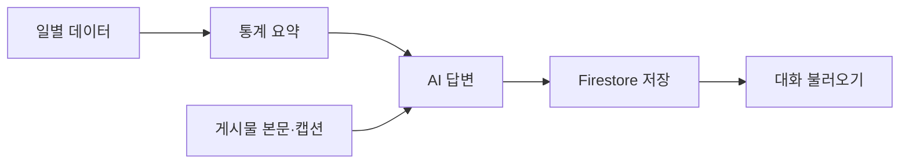
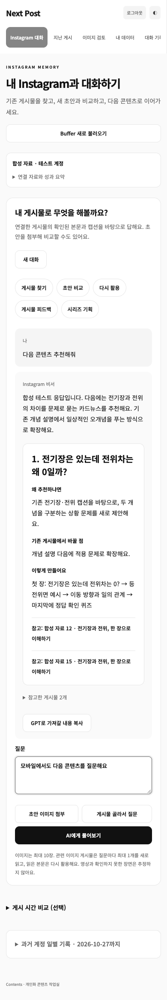
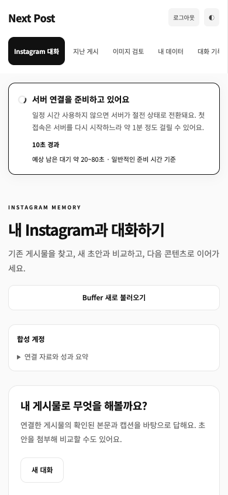

<div align="center">

# Next Post

### 내 Instagram을 읽고, 다음 콘텐츠를 함께 만드는 AI 비서

[서비스 사용하기](https://m1-2-frontend-theta.vercel.app/) · [API 문서](https://m1-2-6ae7.onrender.com/docs) · [백엔드 상태](https://m1-2-6ae7.onrender.com/health)

**FastAPI · Vanilla JavaScript · Firestore · Render · Vercel**

</div>

---

## 무엇을 할 수 있나요?

1. **내 게시물에 질문하기** — 연결된 게시물의 본문·캡션·성과를 바탕으로 답합니다.
2. **다음 콘텐츠 만들기** — 새 이미지 초안을 비교하고, 기존 글을 후속 콘텐츠로 확장합니다.
3. **데이터 관리하기** — 날짜·값·메모를 추가·수정·삭제하고 통계 요약을 확인합니다.
4. **이전 대화 이어가기** — 저장한 질문·답변·작업 결과·참고 자료를 다시 불러옵니다.

**사용 순서:** Google 로그인 → Buffer 자료 불러오기 → 게시물 선택 또는 초안 첨부 → 질문

허용된 사용자만 개인 자료에 접근합니다. 가져온 원본 데이터는 읽기 전용이며, CRUD는 **내 데이터 → 직접 기록**에서 사용합니다.

## 어떻게 동작하나요?



- **분석 데이터:** M1-1의 139일 시계열 기록 + Buffer에서 수집한 게시물 성과
- **AI 입력:** 데이터 요약을 시스템 프롬프트에 주입하고 관련 게시물을 참고 자료로 전달
- **본문 기억:** 이미지 최대 10장을 읽어 저장·재사용하며, 영상 본문은 읽지 않음

## 핵심 설계

- **역할 분리:** 라우터는 요청·인증, 서비스는 업무 흐름, 통계 함수는 계산, 저장소는 Firestore 접근을 담당합니다.
- **데이터 기반 답변:** 화면과 채팅이 같은 요약 함수를 사용하고, 계산한 수치를 시스템 프롬프트에 전달합니다.
- **일관된 저장:** 질문·답변·근거를 함께 저장하고 요청 ID로 중복 생성을 줄입니다. 대화 목록과 메시지는 분리해 불러옵니다.
- **입력과 자료 보호:** Pydantic으로 요청·AI 응답을 검사하고, 사용자별 접근 제어와 원본 데이터 보호를 적용합니다.
- **운영 대응:** 환경 변수로 키·주소를 분리하고, CORS·첫 요청 지연 안내·상태 복구로 연결 흐름을 관리합니다.

[설계 선택과 구현 흐름 더 보기](docs/design-decisions.md)

## 실행하기

<details>
<summary><strong>로컬 실행 방법</strong> — Python 3.10+ · Node.js 22+</summary>

**① 백엔드** · 저장소 루트에서 실행

```bash
python3 -m venv .venv
source .venv/bin/activate
pip install -r backend/requirements.lock
cp .env.example .env
# .env에 아래 서버 환경 변수 입력
uvicorn app.main:app --app-dir backend --reload --port 8000
```

**② 프론트엔드** · 다른 터미널에서 실행

```bash
cp frontend/.env.example frontend/.env.local
# API_BASE_URL과 공개 Firebase 웹 설정 입력
node --env-file=frontend/.env.local frontend/build-config.mjs
python3 -m http.server 3000 --directory frontend/public
```

[로컬 화면](http://localhost:3000) · [로컬 Swagger](http://localhost:8000/docs)

</details>

<details>
<summary><strong>환경 변수와 배포 설정</strong></summary>

**서버 · `.env` / Render**

- 인증·DB: `FIREBASE_SERVICE_ACCOUNT_JSON`, `ALLOWED_USER_UIDS`
- AI 선택: `LLM_PROVIDER`와 선택한 제공업체의 키·모델
  - OpenAI: `OPENAI_API_KEY`, `OPENAI_MODEL`
  - Anthropic: `ANTHROPIC_API_KEY`, `ANTHROPIC_MODEL`, 선택 `ANTHROPIC_BASE_URL`
- Buffer: `BUFFER_API_KEY`, `BUFFER_CHANNEL_ID`, `BUFFER_OWNER_UID`
- 연결·사용량: `ALLOWED_ORIGINS`, `MAX_OUTPUT_TOKENS`, `DAILY_REQUEST_LIMIT`

**프론트 · `frontend/.env.local` / Vercel**

- `API_BASE_URL`: 백엔드 주소
- `FIREBASE_WEB_CONFIG`: 공개 Firebase 웹 설정 JSON

Firebase에서 Google 로그인을 활성화하고 Authorized domains에 로컬·배포 도메인을 등록합니다. Firestore를 생성해 [보안 규칙](firestore.rules)을 적용하고 허용 UID를 설정합니다. 서버 키는 프론트나 Git에 넣지 않습니다.

**Render:** Root `backend` · Build `pip install -r requirements.lock` · Start `uvicorn app.main:app --host 0.0.0.0 --port $PORT`

**Vercel:** Root `frontend` · Build `node build-config.mjs` · Output `public`

`ALLOWED_ORIGINS`에는 실제 프론트 주소를 등록합니다. 로컬 예시는 `http://localhost:3000`입니다.

</details>

## 구현과 검증

- **필수 기능:** 데이터 CRUD · 요약 API · AI 채팅과 로딩 · 대화 저장·불러오기 · 모바일 대응
- **자동 검사:** 백엔드 165개 · 빌드 설정 3개 · 연결 배너 4개 시나리오 · 반응형 3개 크기 통과
- **운영 확인:** 게시물 조회 · 이미지 본문 재사용 · 실제 AI 답변과 대화 저장 확인

### 실행 증거

**① 모바일·작은 화면**

360·390·768px에서 **가로 넘침 없음, 메뉴 이동, 질문 입력, 답변 표시**를 확인했습니다. 합성 데이터와 로컬 FastAPI를 사용한 브라우저 실행 결과입니다.

[반응형 테스트 결과 JSON](docs/evidence/responsive-test.json) · [테스트 코드](tests/e2e/growth.mjs)

<details>
<summary>390px 모바일에서 질문·답변 화면 보기</summary>



</details>

**② 데이터 요약 API**

`GET /api/data/summary`는 별도 라우트이며, `/api` 접두사와 사용자 인증을 적용합니다. [구현 코드](backend/app/routes/resources.py#L50-L58):

<details>
<summary>라우트 코드와 HTTP 200 응답 예시 보기</summary>

```python
@router.get("/data/summary")
def summary(
    start: date | None = None,
    end: date | None = None,
    uid=Depends(require_owner),
    db=Depends(store),
):
    return summarize(db.list("data", uid), start, end)
```

합성 데이터 100개를 데이터 API로 추가한 뒤 아래 요청을 실제 FastAPI 라우트에 실행했습니다. [HTTP 200 실행 결과](docs/evidence/summary-api-test.txt) · [전체 JSON 응답](docs/evidence/data-summary.json)

```http
GET /api/data/summary?start=2026-10-01&end=2026-10-07
```

응답 일부:

```json
{
  "period": {"start": "2026-10-01", "end": "2026-10-07"},
  "count": 7,
  "metrics": {
    "views": {"average": 195.0, "max": 198, "min": 192, "trend": "up"}
  }
}
```

</details>

**③ 배포된 Swagger**

2026-10-27 배포 서버의 `/docs`에서 **HTTP 200**과 Swagger HTML 응답을 확인했습니다.

```bash
curl -i https://m1-2-6ae7.onrender.com/docs
```

[실제 curl 응답](docs/evidence/swagger-http.txt) · [배포 서버에서 확인한 API 목록](docs/evidence/deployed-api.json) · [Swagger 열기](https://m1-2-6ae7.onrender.com/docs)

### 첫 접속 연결 안내

페이지를 열면 로그인 전부터 서버 연결을 확인합니다. [Render 무료 서비스](https://render.com/docs/free#spinning-down-on-idle)는 15분 동안 요청이 없으면 절전 상태로 전환되어 첫 요청에 약 1분이 걸릴 수 있습니다.

상단 배너는 **절전 안내·경과 시간·예상 남은 대기 범위**를 표시하고 서버가 준비되면 자동으로 닫힙니다. 예상 범위는 실측 완료율이 아니며, 90초를 넘으면 무한 요청 대신 **다시 연결** 버튼을 표시합니다. 입력한 질문은 유지됩니다.

<details>
<summary>모바일 서버 연결 배너 보기</summary>



</details>

재현: `pnpm test:server-status` / `CAPTURE_EVIDENCE=1 pnpm test:growth`. 로컬 서버 준비는 [검증 기록](docs/verification.md)을 참고합니다.

### 더 알아보기

- [설계 선택과 구현 흐름](docs/design-decisions.md) — 데이터 구조 · 요청 검증 · 컨텍스트 주입 · 저장과 복구 · 확장 방법
- [검증 기록](docs/verification.md) — 테스트 실행 방법과 실제 확인 범위
- [상세 아키텍처](docs/architecture.md) — 구성 요소와 데이터 흐름

<details>
<summary><strong>화면 예시 보기</strong> — 채팅 · 데이터 관리 · 대화 불러오기</summary>

합성 데이터로 검증한 기능 예시입니다.

**데이터를 참고한 질문과 답변**


**직접 기록 추가와 목록 반영**


**저장한 대화 불러오기**


</details>
