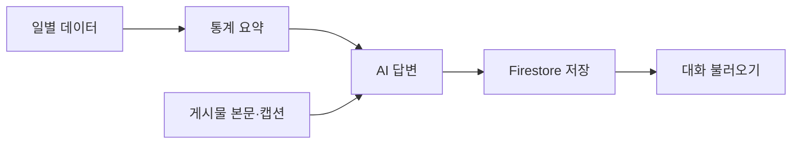

<div align="center">

# Next Post

### 내 Instagram을 읽고, 다음 콘텐츠를 함께 만드는 AI 비서

[서비스 사용하기](https://m1-2-frontend-theta.vercel.app/) · [API 문서](https://m1-2-6ae7.onrender.com/docs) · [백엔드 상태](https://m1-2-6ae7.onrender.com/health)

**FastAPI · Vanilla JavaScript · Firestore · Render · Vercel**

</div>

---

## 무엇을 할 수 있나요?

1. **내 게시물에 질문하기** — 연결된 게시물의 본문·캡션·성과를 바탕으로 답합니다.
2. **다음 콘텐츠 만들기** — 새 이미지 초안을 비교하고, 기존 글을 후속 콘텐츠로 확장합니다.
3. **데이터 관리하기** — 날짜·값·메모를 추가·수정·삭제하고 통계 요약을 확인합니다.
4. **이전 대화 이어가기** — 저장한 질문·답변·작업 결과·참고 자료를 다시 불러옵니다.

**사용 순서:** Google 로그인 → Buffer 자료 불러오기 → 게시물 선택 또는 초안 첨부 → 질문

허용된 사용자만 개인 자료에 접근합니다. 가져온 원본 데이터는 읽기 전용이며, CRUD는 **내 데이터 → 직접 기록**에서 사용합니다.

## 어떻게 동작하나요?



- **분석 데이터:** M1-1의 139일 시계열 기록 + Buffer에서 수집한 게시물 성과
- **AI 입력:** 데이터 요약을 시스템 프롬프트에 주입하고 관련 게시물을 참고 자료로 전달
- **본문 기억:** 이미지 최대 10장을 읽어 저장·재사용하며, 영상 본문은 읽지 않음

## 실행하기

<details>
<summary><strong>로컬 실행 방법</strong> — Python 3.10+ · Node.js 22+</summary>

**① 백엔드** · 저장소 루트에서 실행

```bash
python3 -m venv .venv
source .venv/bin/activate
pip install -r backend/requirements.lock
cp .env.example .env
# .env에 아래 서버 환경 변수 입력
uvicorn app.main:app --app-dir backend --reload --port 8000
```

**② 프론트엔드** · 다른 터미널에서 실행

```bash
cp frontend/.env.example frontend/.env.local
# API_BASE_URL과 공개 Firebase 웹 설정 입력
node --env-file=frontend/.env.local frontend/build-config.mjs
python3 -m http.server 3000 --directory frontend/public
```

[로컬 화면](http://localhost:3000) · [로컬 Swagger](http://localhost:8000/docs)

</details>

<details>
<summary><strong>환경 변수와 배포 설정</strong></summary>

**서버 · `.env` / Render**

- 인증·DB: `FIREBASE_SERVICE_ACCOUNT_JSON`, `ALLOWED_USER_UIDS`
- AI 선택: `LLM_PROVIDER`와 선택한 제공업체의 키·모델
  - OpenAI: `OPENAI_API_KEY`, `OPENAI_MODEL`
  - Anthropic: `ANTHROPIC_API_KEY`, `ANTHROPIC_MODEL`, 선택 `ANTHROPIC_BASE_URL`
- Buffer: `BUFFER_API_KEY`, `BUFFER_CHANNEL_ID`, `BUFFER_OWNER_UID`
- 연결·사용량: `ALLOWED_ORIGINS`, `MAX_OUTPUT_TOKENS`, `DAILY_REQUEST_LIMIT`

**프론트 · `frontend/.env.local` / Vercel**

- `API_BASE_URL`: 백엔드 주소
- `FIREBASE_WEB_CONFIG`: 공개 Firebase 웹 설정 JSON

Firebase에서 Google 로그인을 활성화하고 Authorized domains에 로컬·배포 도메인을 등록합니다. Firestore를 생성해 [보안 규칙](firestore.rules)을 적용하고 허용 UID를 설정합니다. 서버 키는 프론트나 Git에 넣지 않습니다.

**Render:** Root `backend` · Build `pip install -r requirements.lock` · Start `uvicorn app.main:app --host 0.0.0.0 --port $PORT`

**Vercel:** Root `frontend` · Build `node build-config.mjs` · Output `public`

`ALLOWED_ORIGINS`에는 실제 프론트 주소를 등록합니다. 로컬 예시는 `http://localhost:3000`입니다.

</details>

## 구현과 검증

- **필수 기능:** 데이터 CRUD · 요약 API · AI 채팅과 로딩 · 대화 저장·불러오기 · 모바일 대응
- **자동 검사:** 백엔드 165개 · 빌드 설정 3개 · 새 대화 시나리오 6개 · 기존 성장 회귀 9개 통과
- **운영 확인:** 게시물 조회 · 이미지 본문 재사용 · 실제 AI 답변과 대화 저장 확인
- **제출 범위:** 보너스 과제 미수행·미제출

실제 AI 검증은 **Anthropic 호환 API**로 진행했습니다. OpenAI는 구현·전송 테스트까지 확인했으며 실제 호출은 별도 검증이 필요합니다.

### 설계 설명과 평가 자료

- [평가 항목별 설명](docs/evaluation-guide.md) — 구조 분리 · Firestore 설계 · Pydantic · 컨텍스트 주입 · 화면 상태 · CORS · 콜드스타트 · 확장 방법
- [검증 기록](docs/verification.md) — 테스트 실행 방법과 실제 확인 범위
- [상세 아키텍처](docs/architecture.md) — 구성 요소와 데이터 흐름

<details>
<summary><strong>제출 화면 보기</strong> — 채팅 · 데이터 관리 · 대화 불러오기</summary>

합성 데이터로 검증한 기능 예시입니다.

**데이터를 참고한 질문과 답변**


**직접 기록 추가와 목록 반영**


**저장한 대화 불러오기**


</details>
