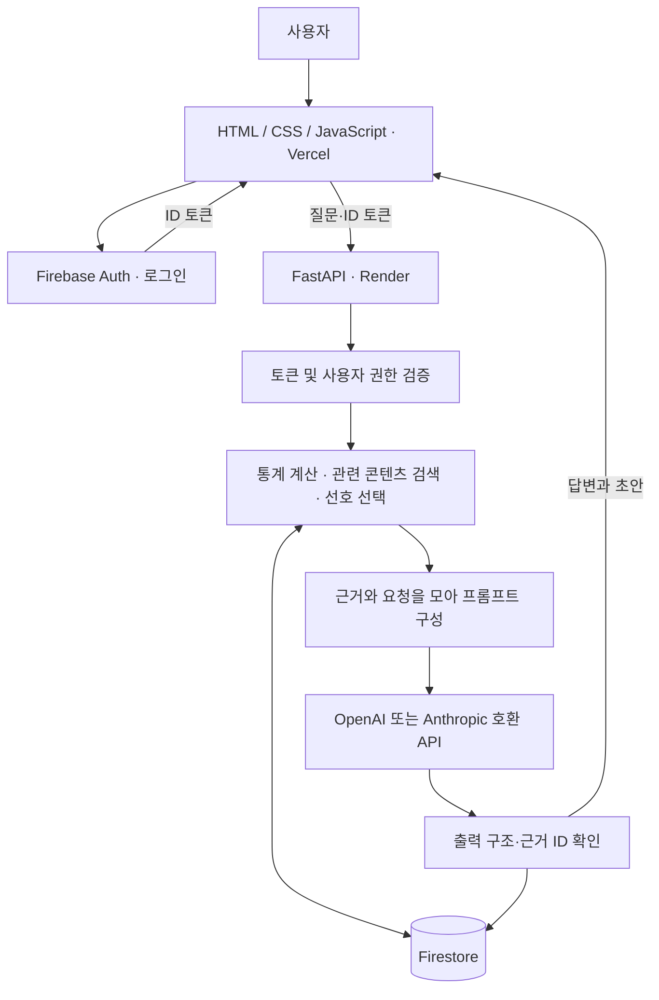

# 개인화 콘텐츠 제작 비서 아키텍처

현재 로컬 구현의 역할과 데이터 흐름입니다. 실제 Firebase·OpenAI 연결과 Render·Vercel 배포는 키 준비 후 검증해야 합니다.

## 각 구성 요소의 역할

| 구성 요소 | 쉬운 설명 | 책임 |
| --- | --- | --- |
| 브라우저 · Vercel | 사용자가 보고 조작하는 화면 | 로그인, 채팅, 원고 편집, 데이터 관리, 대화 불러오기 |
| Firebase Authentication | 사용자의 신원을 확인하는 출입증 발급처 | Google 로그인과 ID 토큰 발급 |
| FastAPI · Render | 요청을 처리하는 서비스 본체 | 토큰 검증, 권한 검사, 검색, 통계, 프롬프트 구성, AI 호출, 저장 |
| Firestore | 사용자별 자료와 기록을 보관하는 저장소 | 데이터, 콘텐츠, 선호, 대화, 초안, 피드백 저장 |
| OpenAI API 또는 Anthropic 호환 API | 제공된 근거를 읽고 초안을 만드는 생성 모델 (`LLM_PROVIDER`로 선택) | 맞춤 답변, 주제와 원고·퀴즈 생성 |

검색·통계·개인화·생성은 FastAPI 내부 모듈입니다. 처음부터 별도 서버나 여러 에이전트로 나누지 않습니다.

## 한 번의 요청이 처리되는 순서

1. 사용자가 로그인하고 질문합니다.
2. 백엔드가 ID 토큰을 검증하고 초기 허용 UID인지 확인합니다.
3. 인증된 UID에 속한 자료만 조회합니다. 클라이언트가 보낸 UID를 신뢰하지 않습니다.
4. 시계열 통계는 Python으로 계산하고, 관련 원고와 확인된 선호를 선택합니다.
5. 현재 요청, 관련 자료, 선호, 통계를 모델에 전달합니다.
6. 답변 형식과 참조 ID를 검사하고 대화·초안을 저장합니다.
7. 화면에 결과를 표시합니다. 사용자가 수정하면 피드백을 기록하고, 지속 적용할 선호는 사용자 확인 후 저장합니다.

## 개인화 기준

현재 요청 → 해당 시리즈의 규칙 → 일반 제작 선호 순으로 적용합니다.

초기에는 선택한 콘텐츠와 키워드 검색을 사용합니다. 검색 품질을 평가한 뒤 필요할 때 임베딩 검색을 추가합니다.
ChatGPT 프로젝트의 자료는 자동 접근할 수 있다고 가정하지 않으며, 사용자가 제공한 내보내기 자료를 검토해서 가져옵니다.

## Firestore 컬렉션 계획

모든 문서는 owner_uid를 갖습니다.

- data: 날짜, 값, 메모 및 지표 종류
- conversations: 대화 제목과 사용자별 대화 기록
- conversations/{id}/messages: 메시지 및 생성 당시 근거
- contents: 기존 원고, 주제, 형식, 출처
- profiles: 확인된 일반 선호
- series: 시리즈별 규칙
- drafts: 생성 초안과 수정 버전
- feedback: 수정 전후 원고와 사용자 메모 (선호 자동 반영 없음)
- requests: 요청 예약·완료 응답·삭제 tombstone
- quotas: UTC 날짜별 사용자 모델 호출 시도 횟수

Admin SDK는 Firestore 보안 규칙을 우회하므로 모든 API의 목록·단건 조회·수정·삭제에서 소유권을 검사합니다. 초기에는 브라우저의 Firestore 직접 접근을 차단합니다.

## 필수 API

- POST /api/data
- GET /api/data
- GET /api/data/summary
- PUT /api/data/{id}
- DELETE /api/data/{id}
- POST /api/chat
- POST /api/conversations
- GET /api/conversations
- GET /api/conversations/{id}
- DELETE /api/conversations/{id}

POST /api/chat은 summary API와 동일한 서비스 함수로 통계를 얻고, 프롬프트에 주입해 AI를 호출한 뒤 대화를 자동 저장합니다.
추가 계약은 `/docs`에 정의되어 있습니다. 프로필·시리즈 저장은 confirmed=true를 요구하며 원고 수정은 version 일치 여부를 검사합니다.

## 데이터와 생성의 한계

- M1-1의 계정 단위 지표만으로 게시물별 성공 원인이나 전환율을 단정하지 않습니다.
- 0과 결측값을 구분하고 통계에 사용한 기간·표본 수를 표시합니다.
- 원고를 검색 근거로 사용하되, 원고 내부 문구를 시스템 명령으로 취급하지 않습니다.
- 생성한 과학 설명·수식·정답은 검토 대상입니다. 형식 검사만으로 사실 검증을 완료했다고 표시하지 않습니다.
- 자동 게시와 이미지 자동 생성은 초기 범위에 포함하지 않습니다.

## 구현 순서

인증·설정 → 데이터 CRUD·요약 → 자료 가져오기·검색 → 맞춤 채팅·초안 → 대화·피드백 → 화면 → 배포 검증.

요청 길이·출력 토큰·사용자별 요청 수를 제한하고 외부 API 오류를 처리합니다. Render 콜드스타트 시 로딩 안내를 표시합니다.
